# 초록집사

식물을 처음 키우는 사람을 위한 반려식물 돌봄 서비스 소개 페이지입니다. uiuxprogramming 과제로 만들었습니다.

- 배포 페이지: https://jjiiiinn.github.io/uiuxprogramming/
- 저장소: https://github.com/JJIIIINN/uiuxprogramming

## 서비스 개요

| 항목 | 내용 |
| --- | --- |
| 주요 사용자 | 식물을 처음 키우는 자취생·직장인, 물 주는 시기를 자주 놓치는 사람 |
| 서비스 목적 | 식물마다 알맞은 물주기 일정을 알려 줘서 반려식물을 시들지 않게 키우도록 돕기 |
| 사용자 목표 | 내 식물에 맞는 날짜에 물주기 알림 받기 |
| 핵심 행동 | 내 식물을 등록하고 물주기 알림 신청하기 |
| 완료 조건 | 식물 이름·종류·놓아둔 자리와 이메일·알림 시간을 조건에 맞게 입력하고(문자 알림을 켜면 휴대폰 번호도), 확인 화면에서 수신 동의에 체크한 뒤 `알림 신청하기`를 눌러 신청이 저장되면 완료 화면에 첫 알림 날짜가 표시됨 |

페이지 구성: 상단 바(메뉴) → 첫 화면 → 서비스 소개 → 주요 기능(탭 3개) → 이용 방법 → 물주기 알림 신청 → 내 식물 목록 → 자주 묻는 질문(아코디언) → 푸터 (+ 모달 2개)

## 13주차: 작성 상태 복구와 사용자 테스트

`물주기 알림 신청`을 작성하다가 최종 저장 전에 새로고침하면 처음으로 돌아가던 문제를 확인하고, 같은 탭에서 새로고침해도 작성하던 화면과 값을 이어서 쓸 수 있게 고쳤습니다.

- 사용자 테스트(양식 A–E), 수정, 재검증 기록: [docs/week13-user-test.md](docs/week13-user-test.md) — P01 1차 테스트 → 관찰한 문제 3건 수정(커밋 `fb1e9db`) → 같은 과업으로 2차 테스트. 요약은 아래 [3번](#3-사용자-테스트와-수정재검증)
- 아래 1·2번과 회귀 QA는 내가 직접 한 QA 기록이고, 참여자 테스트 기록은 위 파일에 따로 남깁니다.

### 1. 과업 기반 QA (개선 전)

대표 과업: **내 식물을 등록하고 물주기 알림을 이메일과 문자로 신청하기** (서비스의 핵심 행동)

| 항목 | 내용 |
| --- | --- |
| 시작 조건 | 12주차 버전(커밋 `95ed3b6`). Chrome 158(macOS), 창 너비 1100px. 페이지를 새 탭에서 열고, 신청 기록이 없는 상태(내 식물 목록 0개). `알림 신청`에서 `등록 시작하기` → 식물 이름 `몬스테라 몽이`, 이메일 `green@example.com`, 휴대폰 `010-1234-5678` 입력 |
| 선택 상태 | 종류 `몬스테라`, 자리 `햇빛 드는 창가`, `문자(SMS)로도 알림 받기` 체크, 알림 시간 `직접 정하기` 오전 7:30, `수신 동의` 체크, 3단계(확인) 화면 |
| 행동 | **`알림 신청하기`를 누르기 전에 새로고침**(⌘R 또는 F5) |
| 기대 결과 | 새로고침 뒤에도 확인 화면(3단계)이 그대로 보이고, 입력·선택한 값과 수신 동의가 남아 있으며, 아직 신청 전이라는 것을 알 수 있다 |
| 실제 결과 | 시작 화면(`내 식물 등록하고 물주기 알림 받기`)으로 돌아가고 진행 표시 네 칸이 모두 회색이 됨. `등록 시작하기`를 다시 누르면 식물 이름 `0 / 20자`, 종류 `선택해 주세요`, 자리 미선택이고, 이메일·문자 체크·휴대폰 번호·알림 시간·수신 동의도 모두 비어 있음. 내용이 사라졌다는 안내가 없음. 신청 기록은 0개(저장되지 않음) |
| 예상 사용자 영향 | 입력·선택 9가지를 처음부터 다시 해야 함. 화면이 아무 말 없이 처음으로 돌아가서 신청이 됐는지 안 됐는지 알 수 없고, `내 식물 목록`까지 내려가 확인해야 함. 휴대폰에서는 당겨서 새로고침이나 다른 앱에 다녀온 뒤 다시 불러오기로 쉽게 일어나는 상황이라, 다시 입력하지 않고 신청을 그만둘 수 있음 |
| 재확인 | 수정한 뒤 같은 값으로 3단계에서 새로고침해 입력값·선택값·요약·안내를 확인 (아래 2번의 `같은 과업을 개선 후 다시 실행한 결과`) |

- 직접 본 결과: 새로고침 뒤 빈 시작 화면이 열렸습니다. 같은 방법으로 1단계·2단계 작성 중에 새로고침해도 결과가 같았습니다(시작 화면, 빈 값).
- 원인(코드에서 확인): 신청 흐름의 값과 진행 단계가 화면과 JavaScript 변수에만 있고 어디에도 저장되지 않았습니다. `localStorage`에는 `알림 신청하기`에 성공한 신청만 저장합니다.

| 판단 기준 | 확인한 내용 |
| --- | --- |
| 빈도 | 같은 조건으로 1100px·390px에서 3번씩 해서 6번 모두 생김 |
| 범위 | 1·2·3단계 어디서 새로고침해도 생김. 1100px·390px 모두 같음 (Chrome에서만 확인) |
| 심각도 | 신청을 끝낼 수는 있지만 입력·선택 9가지를 모두 다시 해야 함 |
| 복구 가능성 | 도움 없이 다시 시작할 수는 있음. 사라진 값을 되찾을 방법은 없음 |

→ 다시 입력해야 하는 양이 많고 매번 생기므로 먼저 고칠 문제로 정했습니다.

| 새로고침 전: 확인 화면 | 새로고침 후(개선 전): 시작 화면, 값 없음 |
| --- | --- |
| 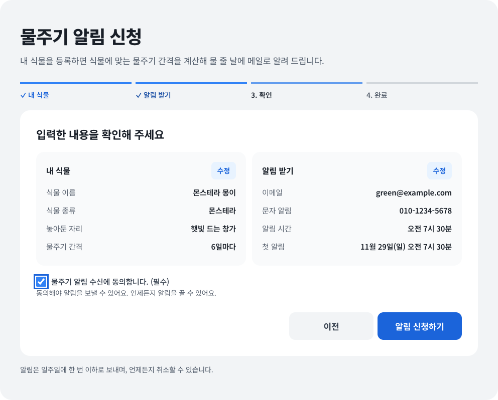 | 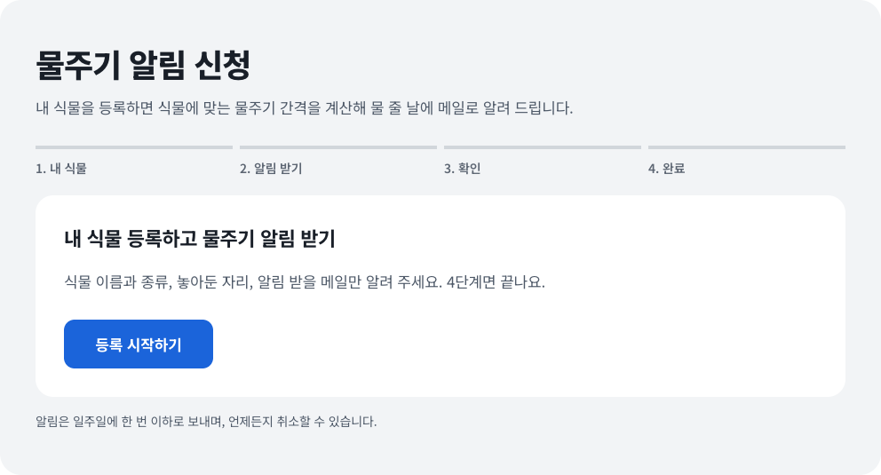 |

### 2. 작성 상태 복구 구현

**무엇을 보관하나** — 값을 입력하거나 고를 때, 단계가 바뀔 때마다 아래 내용을 한 묶음으로 보관합니다.

| 구분 | 보관하는 내용 |
| --- | --- |
| 입력값 | 식물 이름, 이메일, 휴대폰 번호, 직접 정한 알림 시간 |
| 선택값 | 식물 종류, 놓아둔 자리, 문자 알림 체크, 알림 시간, 수신 동의 체크 |
| 진행 단계 | 시작 · 1단계(내 식물) · 2단계(알림 받기) · 3단계(확인) 중 어디였는지 |
| 생김새로 찾기 | 찾기로 고른 식물인지, 찾기 영역이 열려 있었는지, 검색어와 검색 여부 |
| 보관한 시각 | 안내 문구에 "오후 2시 14분"처럼 표시 |

**어디에 보관하나** — `sessionStorage`의 `chorok-signup-draft`. 같은 탭을 새로고침하면 남고 탭을 닫으면 브라우저가 지웁니다. 이메일·전화번호가 들어 있어서 브라우저에 계속 남는 `localStorage`(신청 기록 `chorok-signups`가 쓰는 곳)와 나눴고, 다른 탭에서 새로 시작한 신청과 섞이지 않습니다.

**언제 복구하고 언제 지우나**

| 상황 | 동작 |
| --- | --- |
| 값을 입력·선택함, 단계를 이동함, 생김새로 찾기를 열고 닫거나 검색함 | 입력·선택한 값이 하나라도 있으면 임시 보관(아무것도 없으면 보관하지 않고 표시도 없음). 폼 위 표시줄에 `✓ 임시 보관됨 · 오후 2시 14분 · 이 탭을 새로고침해도 이어서 작성할 수 있어요.` |
| 같은 탭을 새로고침함 | 보관한 값을 다시 채우고, 값에 따라 달라지는 화면(문자 번호·직접 정한 시간 입력칸, 글자 수, 입력 확인 문구, 찾은 식물 안내, 확인 화면 요약)을 함께 되살린 뒤 작성하던 단계를 보여 줌 |
| 복구한 직후 | 파란 안내 상자: `↻ 작성 중이던 ‘몬스테라 몽이’ 알림 신청을 불러왔어요. 아직 신청이 끝나지 않았어요. 내용을 확인하고 아래 ‘알림 신청하기’를 누르면 신청이 끝나요.`(1·2단계는 `2단계 ‘알림 받기’부터 이어서 작성해 주세요.`) + `안내 닫기` · `처음부터 다시 작성`. 신청 영역을 보고 있었다면 안내가 보이게 화면을 맞추고 초점을 안내로 옮김 |
| `안내 닫기`를 누르거나 다른 단계로 이동함 | 안내 상자를 접고 임시 보관 표시만 남김 (누르지 않아도 그대로 이어서 작성할 수 있음) |
| `처음부터 다시 작성` | 값이 있으면 확인 창(12주차 `askConfirm` 모달을 다시 사용)을 먼저 띄우고, 확인 창은 지워지는 것(식물 정보, 이메일·전화번호·시간)과 남는 것(신청을 끝낸 식물 목록)을 알려 줌. `지우고 다시 시작`을 누르면 입력값·선택값·임시값을 모두 지우고 시작 화면으로 가서 `✓ 작성하던 내용을 모두 지웠어요. …` 안내를 보여 줌. `취소`·Esc면 그대로 |
| `알림 신청하기`로 저장에 성공함 | 신청 기록을 `localStorage`에 저장한 뒤 임시값을 지우고 입력칸도 비움. 완료 화면에서 새로고침해도 끝난 신청이 작성 중으로 되살아나지 않음 |
| 신청에 실패함(연결 끊김, 이미 신청한 식물, 저장 불가) | 임시값을 그대로 둠. 새로고침해도 확인 화면에서 다시 신청할 수 있음 |
| `신청하는 중…`(1.5초)에 새로고침함 | 저장되기 전이므로 확인 화면으로 복구. 신청 기록은 생기지 않음 |
| `신청하는 중…`에 `처음부터 다시 작성`을 누름 | 버튼을 잠가서 눌리지 않음. 보내는 중에 값이 지워지지 않음 |

**예외 처리**

- 보관한 내용이 깨져 있으면 무시하고 지운 뒤 시작 화면을 보여 줍니다.
- 목록에 없는 선택값(식물 종류·자리·시간)은 버리고, 앞 단계에 빈 칸이나 오류가 있으면 그 단계부터 보여 줍니다(빈 확인 화면이 열리지 않게).
- 브라우저가 저장을 막아 보관하지 못하면 `⚠︎ 이 브라우저에서는 작성 내용을 임시 보관할 수 없어요. 새로고침하거나 탭을 닫으면 입력한 내용이 사라져요.`라고 알리고 입력은 계속할 수 있습니다.
- 다른 영역(예: 자주 묻는 질문)을 보다가 새로고침했다면 보던 위치와 초점을 그대로 둡니다. 신청 영역으로 돌아오면 복구 안내가 보입니다.
- `자주 묻는 질문 > 등록한 식물은 어디에 저장되나요?` 답변에 임시 보관 설명을 더했습니다.

**복구하지 않는 것**: 항목 아래 빨간 오류 문구(`다음`을 누르면 다시 표시), 주요 기능 탭의 체험 입력값, 내 식물 목록의 필터 선택.

**주요 함수** (`script.js` 11번)

| 함수 | 하는 일 |
| --- | --- |
| `collectDraft()` / `saveDraft()` | 지금 화면의 값과 단계를 모아 보관. 완료 화면이거나 시작 화면에 값이 없으면 보관하지 않고 지움 |
| `restoreDraft()` | 페이지를 열 때 보관한 내용을 검사해 값·화면·단계·안내를 복구 |
| `clearDraft()` | 임시값 삭제. `restartSignup()`(다시 작성)과 `finishSignup()`(저장 성공)에서 호출 |
| `updateDraftBar(상태)` | 표시줄을 보관됨 · 복구 안내 · 지웠다는 안내 · 보관 불가 · 숨김으로 전환 |
| `askRestart()` | 값이 있으면 확인 모달을 띄운 뒤 다시 시작 |

**같은 과업을 개선 후 다시 실행한 결과** (1번 표와 같은 시작 조건·행동)

| 기대 결과 | 개선 후 실제 결과 | 판정 |
| --- | --- | --- |
| 확인 화면이 그대로 보인다 | 3단계 `입력한 내용을 확인해 주세요` 화면, 진행 표시 `3. 확인` | 통과 |
| 입력·선택한 값과 수신 동의가 남아 있다 | 9가지 값 모두 같음. 문자 번호·직접 정한 시간 입력칸도 보이는 상태, 요약의 첫 알림 날짜도 같음 | 통과 |
| 아직 신청 전이라는 것을 알 수 있다 | 복구 안내에 "아직 신청이 끝나지 않았어요. 내용을 확인하고 아래 ‘알림 신청하기’를 누르면 신청이 끝나요." 신청 기록 0개 | 통과 |
| (추가) `알림 신청하기` → 완료 후 새로고침 | 시작 화면, 복구 안내 없음, 빈 입력칸. 신청한 식물은 내 식물 목록에 있음 | 통과 |

| 새로고침 후(개선 후): 확인 화면과 복구 안내 (1100px) | 2단계 작성 중 새로고침 (390px) |
| --- | --- |
| 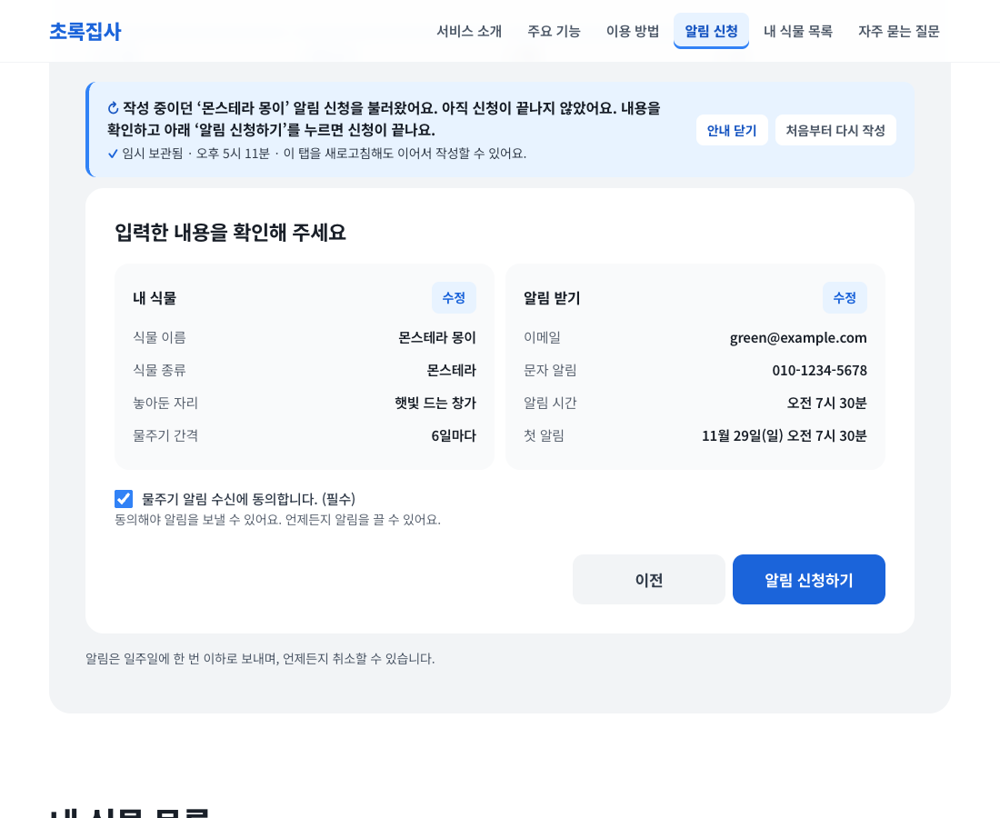 | 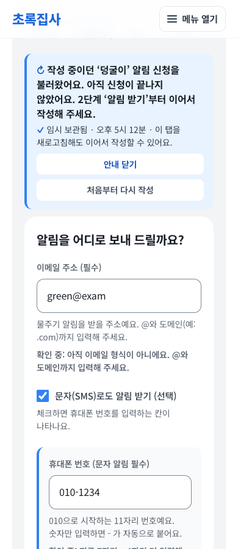 |

| 작성 중 임시 보관 표시 (390px) | 처음부터 다시 작성 확인 창 (1100px) |
| --- | --- |
| 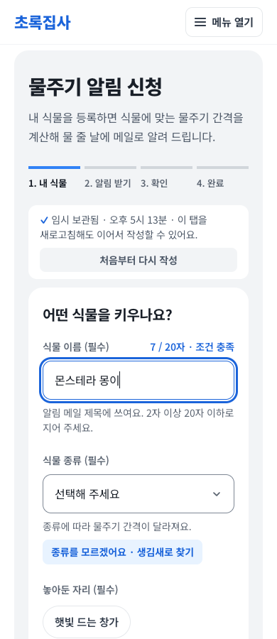 | 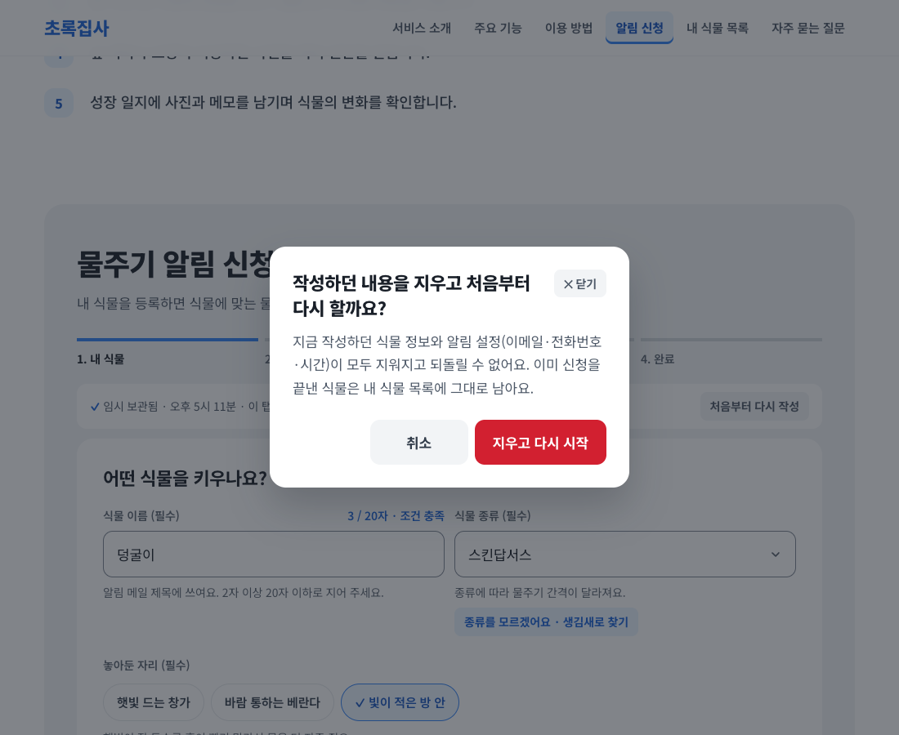 |

### 3. 사용자 테스트와 수정·재검증

2026-11-23에 참여자 P01이 버전 `dd879f3`으로 과업 두 개를 수행했습니다. 과업 조건, 관찰 기록, 사후 응답 전체는 [기록 파일](docs/week13-user-test.md)에 있습니다.

| 과업 | 1차 결과 | 사후 응답 (쉬움 / 상태 명확) |
| --- | --- | --- |
| T1 대표 과업: 확인 화면에서 새로고침된 신청을 마저 끝내기 | 독립 완료 · 약 28초 · 재입력 0회 · 도움 0회 | 4점 / 5점 |
| T2 다른 경로: 적던 내용을 버리고 새 화분으로 처음부터 신청 | 독립 완료 · 약 67초 · 도움 0회 · 짧은 망설임 3번 | 4점 / 4점 |

관찰한 문제와 수정 (커밋 `fb1e9db`)

| 문제 | 관찰 근거 (P01) | 수정 |
| --- | --- | --- |
| 지운 뒤 지워졌다는 안내가 없고, 빈 1단계에 `임시 보관됨`이 뜸 | T2에서 `지우고 다시 시작` 뒤 빈 진행 표시를 보고 지워졌다고 짐작함. 빈 1단계의 `임시 보관됨 · 오후 4시 59분`을 보고 무엇이 보관됐는지 헷갈려 망설임. 상태 명확 4점의 이유 | 지운 뒤 시작 화면에 `✓ 작성하던 내용을 모두 지웠어요. 처음부터 다시 작성할 수 있어요. 신청을 끝낸 식물은 내 식물 목록에 그대로 있어요.` 표시. 입력·선택한 값이 없으면 보관하지 않고 `임시 보관됨`도 띄우지 않음 |
| 다시 작성하면 무엇이 지워지고 남는지 확인 창이 다 알려 주지 않음 | 사후 6번: T1 "이메일까지 지워지는지는 확신 없었음", T2 "신청 끝낸 식물 목록은 남을 것 같지만 확인 창에 그 말은 없음" | 확인 창 문구를 `지금 작성하던 식물 정보와 알림 설정(이메일·전화번호·시간)이 모두 지워지고 되돌릴 수 없어요. 이미 신청을 끝낸 식물은 내 식물 목록에 그대로 남아요.`로 변경 |
| `이어서 작성하기`를 꼭 눌러야 하는지 알 수 없음 | T1에서 버튼을 누른 뒤 아래 `알림 신청하기`를 누름. 쉬움 4점의 이유: "내용이 이미 화면에 있는데 꼭 눌러야 하는지 몰랐고, 신청 버튼이 화면 아래에 있었음" | 버튼 이름을 `안내 닫기`로 변경. 확인 단계의 복구 안내를 `내용을 확인하고 아래 ‘알림 신청하기’를 누르면 신청이 끝나요.`로 바꿔 다음에 누를 버튼을 알려 줌 |

- 화면이 아니라 과업 문장 때문에 생긴 혼동 2건(입력칸 예시와 같은 이메일 주소, "이름을 모르는 식물")은 과업지를 고쳤고, 2차에서 달라진 조건으로 기록합니다.
- 고치지 않은 것: 생김새로 찾기 결과의 "기본 14일"과 확인 화면의 "17일마다"가 다른 이유를 설명하지 않음(P01은 자리 때문이라고 짐작함).

2차 테스트 (같은 날, 같은 참여자 P01, 같은 과업, 수정한 버전 `fb1e9db`)

| 항목 | 1차 · 수정 전 | 2차 · 수정 후 |
| --- | --- | --- |
| T1 결과 | 독립 완료 · 약 28초 · 재입력 0 · 도움 0 | 독립 완료 · 약 28초 · 재입력 0 · 도움 0 |
| T1 사후 응답 (쉬움 / 상태 명확) | 4점 / 5점 | 5점 / 5점 |
| T2 결과 | 독립 완료 · 약 67초 · 도움 0 · 짧은 망설임 3번 | 독립 완료 · 약 1분 · 도움 0 · 종류 선택지를 잠깐 찾음 |
| T2 사후 응답 (쉬움 / 상태 명확) | 4점 / 4점 | 4점 / 5점 |

| 문제 | 2차에서 본 것 | 판단 |
| --- | --- | --- |
| 지운 뒤 안내 | 빈 1단계에서 망설이지 않음. 상태 명확 4 → 5점. 안내는 떴지만 참여자가 든 근거는 "입력칸이 빈 것"이었음 | 망설임은 없어짐. 안내 문구가 읽혔는지는 확인하지 못함 |
| 확인 창 문구 | 지워지는 것은 이메일까지 망설임 없이 답함. 신청을 끝낸 식물 목록이 남는다는 말은 하지 않음 | 지워지는 것은 개선. 남는 것은 확인하지 못함 |
| 복구 안내 버튼 | 2차에서도 `안내 닫기`를 누른 뒤 신청함. "신청만 누르면 되는거지?"라고 말함. 쉬움 4 → 5점 | 버튼은 여전히 누름. 다음에 할 일은 더 분명해짐. 수행 시간은 그대로 |

반복 수행의 영향과 한계

- 같은 참여자가 같은 날 같은 과업을 다시 해서 익숙해진 영향이 섞여 있습니다. 참여자도 "두 번째라 복원 안내는 바로 이해했다"고 말했습니다.
- 참여자는 1차 T2에서 다시 작성과 확인 창을 이미 겪었기 때문에, 2차에서 "이메일도 지워진다"고 답한 것이 바뀐 문구 때문인지 1차 경험 때문인지는 가를 수 없습니다.
- T1 수행 시간은 1·2차가 같아서 수정으로 빨라졌다고 말할 수 없습니다. T2는 2차에 `생김새로 찾기`를 찾는 데 시간이 더 걸렸는데, 과업 문장을 "이름을 모르는"에서 "종류를 모르는"으로 바꾼 영향일 수 있습니다.
- 참여자 1명이라 처음 보는 사람에게도 같은 결과가 나오는지는 확인하지 못했습니다.
- 수정 후 회귀 QA는 아래 표와 기록 파일의 양식 E에 통과·실패·미확인으로 적었습니다.

| 수정 전: 복구 안내 (1차 버전) | 수정 후: 복구 안내 |
| --- | --- |
| 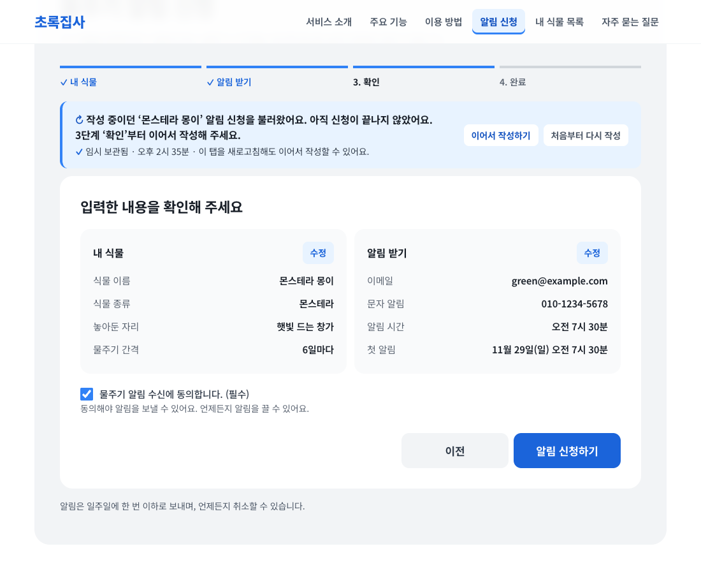 |  |

| 수정 전: 다시 작성 확인 창 (1차 버전) | 수정 후: 지운 뒤 안내 |
| --- | --- |
| 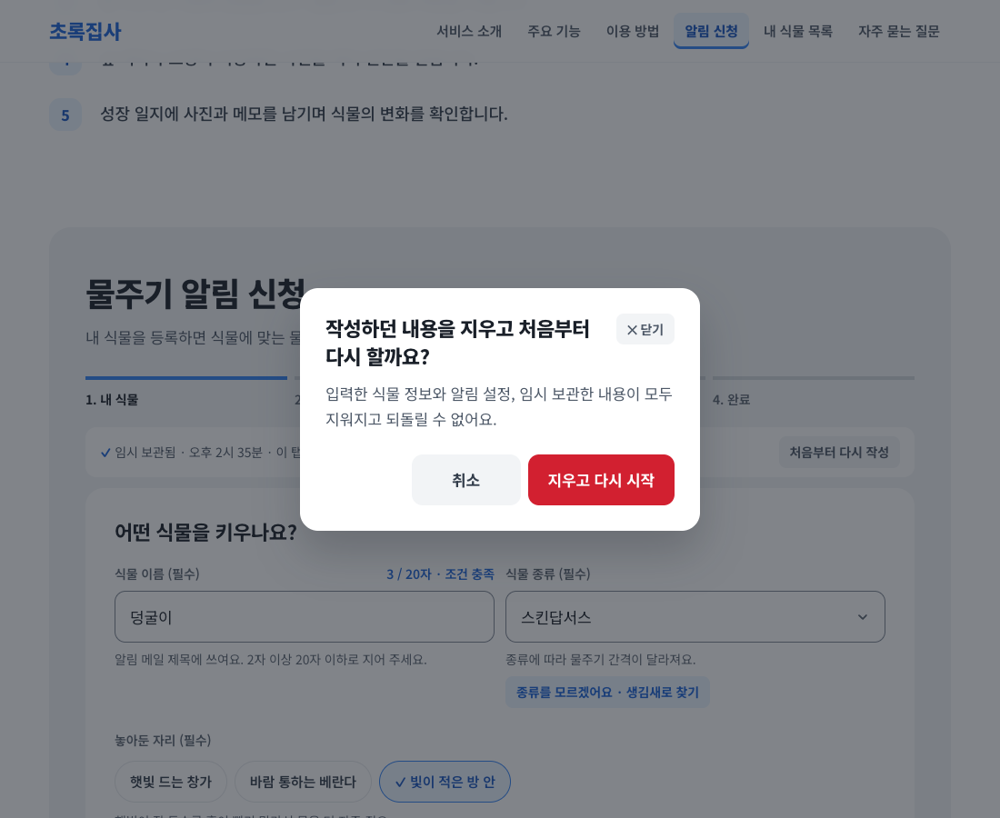 | 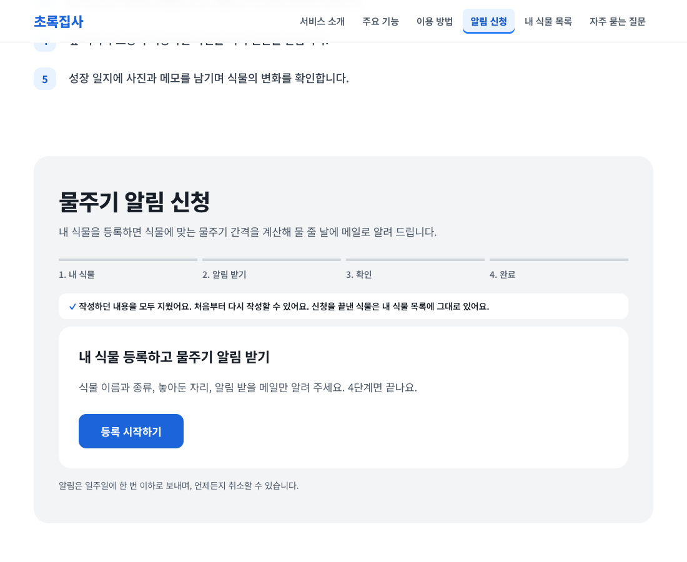 |

### 기능 회귀 QA 결과

2026-11-23, Chrome 158을 스크립트(Puppeteer)로 조작해 실제 클릭과 키 입력으로 확인했습니다. 사용자 테스트 1차 뒤 수정한 버전(커밋 `fb1e9db`)에서 56가지 항목을 4개 너비로 실행해 로컬과 **배포 페이지**(https://jjiiiinn.github.io/uiuxprogramming/) 모두 224개가 통과했습니다. 1차 테스트 버전(`dd879f3`)의 결과와 나란히 [기록 파일의 양식 E](docs/week13-user-test.md#회귀-qa--통과--실패--미확인)에도 적었습니다.

- 처음 확인에서 실패한 항목: `신청하는 중…`에 `처음부터 다시 작성`을 누르면 확인 창이 열리고, `지우고 다시 시작`을 누르면 값이 지워진 채 이름·이메일이 빈 신청이 저장됐습니다. 신청하는 동안 버튼을 잠그도록 고친 뒤(커밋 `dd879f3`) 통과했습니다.

| 확인 항목 | 1100px | 768px | 390px | 320px |
| --- | :---: | :---: | :---: | :---: |
| 값을 입력하면 `임시 보관됨 · 시각` 표시 | 통과 | 통과 | 통과 | 통과 |
| 대표 과업: 확인 화면에서 새로고침 → 단계·입력값·선택값·조건부 입력칸·요약·수신 동의 복구 | 통과 | 통과 | 통과 | 통과 |
| 복구 안내 문구(식물 이름, 아직 신청 전, 이어서 할 단계)와 초점 이동, 안내가 화면 안에 보임 | 통과 | 통과 | 통과 | 통과 |
| 새로고침만으로는 신청이 저장되지 않음 · `신청하는 중…`에 새로고침해도 저장되지 않고 확인 화면 복구 | 통과 | 통과 | 통과 | 통과 |
| 1단계(일부 입력) · 2단계(쓰다 만 이메일·번호, 문자 체크, 시간) 새로고침 → 그대로 복구, 글자 수·입력 확인 문구도 복구 · 아무것도 입력하지 않은 1단계는 보관 표시가 없고 새로고침하면 시작 화면 | 통과 | 통과 | 통과 | 통과 |
| 문자 체크를 푼 상태 복구 · 값을 둔 채 시작 화면으로 돌아간 상태 복구 | 통과 | 통과 | 통과 | 통과 |
| 다른 경로(생김새로 찾기): 검색 결과를 보다 새로고침, 고른 뒤 새로고침, 확인 화면의 `(생김새로 찾음)`, 수정으로 돌아가 종류 변경 | 통과 | 통과 | 통과 | 통과 |
| 다음 단계로 가거나 `안내 닫기`를 누르면 안내가 접힘 · 키보드(Tab, Enter)로 조작 | 통과 | 통과 | 통과 | 통과 |
| `처음부터 다시 작성`: 확인 창(초점 `취소`) → Esc면 그대로 → `지우고 다시 시작`이면 값·임시값 삭제와 `모두 지웠어요` 안내, 새로고침해도 복구 없음 · 지운 뒤 빈 1단계에는 `임시 보관됨`이 뜨지 않고 입력을 시작하면 표시 | 통과 | 통과 | 통과 | 통과 |
| 저장 성공 → 임시값 삭제·입력칸 비움·완료 문구 유지 → 새로고침하면 시작 화면, 식물은 목록에 있음 | 통과 | 통과 | 통과 | 통과 |
| `신청하는 중…`에는 `처음부터 다시 작성`이 잠김 · 끝나면 풀림 · 빈 신청이 저장되지 않음 | 통과 | 통과 | 통과 | 통과 |
| 신청 실패(이미 신청한 식물) 뒤 새로고침 → 값과 확인 화면 유지 · 신청 실패(인터넷 연결 끊김) → 값·임시값 유지, 연결 뒤 다시 신청하면 완료 | 통과 | 통과 | 통과 | 통과 |
| 깨진 임시값 무시 · 잘못된 선택값 버림 · 앞 단계가 비면 그 단계부터 · 보관 불가 안내 | 통과 | 통과 | 통과 | 통과 |
| 새 탭에서는 복구되지 않음 · 다른 영역을 보다 새로고침하면 보던 위치 유지 | 통과 | 통과 | 통과 | 통과 |
| 기존 기능: 주요 기능 탭, 물주기 계산, 잎 진단, 성장 일지 | 통과 | 통과 | 통과 | 통과 |
| 기존 기능: 빈 칸 오류·요약 안내·초점, 조건부 입력 검사, 수신 동의 검사, 신청 중 버튼 비활성, 완료 → 목록 추가, 완료 화면의 `처음부터 다시 신청하기` | 통과 | 통과 | 통과 | 통과 |
| 기존 기능: 내 식물 목록(예시·필터·오늘 물 줬어요), 삭제 확인 모달, 계산 기준 모달, 아코디언, 상단 메뉴 | 통과 | 통과 | 통과 | 통과 |
| axe-core 자동 검사 (복구 안내 화면, 다시 작성 확인 창, 지웠다는 안내 화면, 임시 보관 표시 화면, 처음 화면·아코디언 펼침) | 위반 0건 | 위반 0건 | 위반 0건 | 위반 0건 |
| 가로 스크롤 없음 · 콘솔 JavaScript 오류 없음 | 통과 | 통과 | 통과 | 통과 |

| 확인하지 못한 항목 | 결과 | 이유 |
| --- | :---: | --- |
| Safari · Firefox에서의 복구 | 미확인 | Chrome에서만 실행함 |
| 실제 휴대폰(당겨서 새로고침, 다른 앱에 다녀온 뒤 다시 불러오기) | 미확인 | 컴퓨터 Chrome의 창 너비만 줄여 확인함 |
| 화면 낭독기가 복구 안내를 실제로 읽는지 | 미확인 | 초점 이동과 `role="status"`까지만 확인함 |
| 탭을 닫았다가 `닫은 탭 다시 열기`로 열었을 때 | 미확인 | 브라우저가 탭 저장소를 되살리는지에 따라 달라짐 |

- QA 중 발견한 기존 문제(이번에 고치지 않음): 좁은 화면에서 글자 입력칸에 조건에 안 맞는 값을 둔 채 바로 아래 선택 버튼을 마우스로 누르면, 입력칸을 벗어나는 순간 오류 문구가 나타나 화면이 아래로 밀리면서 그 클릭이 선택되지 않는 경우가 있었습니다(자동 클릭에서 확인, 실제 사용자에게 얼마나 일어나는지는 미확인).

## 12주차: 재사용 가능한 UI 컴포넌트

초록집사에 필요한 **모달**과 **아코디언**을 새로 만들고, 6주차부터 쓰던 **탭**을 어느 탭 묶음에도 쓸 수 있는 공통 함수로 고쳤습니다. 세 컴포넌트 모두 "HTML 구조 약속 + 공통 CSS 클래스 + 공통 JavaScript 함수"로 만들어서, 같은 구조로 HTML만 추가하면 새 모달·아코디언·탭이 바로 동작합니다.

### 구현한 컴포넌트

| 컴포넌트 | 어디에 | 사용 목적 | 동작 방법 |
| --- | --- | --- | --- |
| **모달 ①** 물주기 간격 계산 기준 | 주요 기능 > 물주기 알림 탭의 `물주기 간격 계산 기준 보기`, 자주 묻는 질문 1번의 `식물별 계산 기준표 보기` | "왜 6일마다예요?"라는 궁금증에 답하기. 식물 9종 × 자리 3곳의 간격표를 페이지 흐름을 끊지 않고 잠깐 띄워 보여 줌 | 버튼을 누르면 화면 가운데에 열리고 뒤 화면이 어두워짐. `확인했어요`·`닫기`·Esc·바깥 어두운 곳 클릭으로 닫힘. 닫히면 누른 버튼으로 초점이 돌아감 |
| **모달 ②** 삭제 확인 | 내 식물 목록의 각 식물 `삭제` | 이전에는 `삭제`를 누르면 바로 지워져 실수로 누르면 되돌릴 수 없었음. 되돌릴 수 없는 동작 전에 한 번 더 확인 | `삭제`를 누르면 "‘몽이’를 목록에서 삭제할까요?" 확인 창이 열리고 초점은 안전한 `취소`에 놓임. `삭제하기`(빨간 버튼)를 누르면 삭제 후 결과 안내로 초점 이동. `취소`·`닫기`·Esc를 누르면 "삭제를 취소했어요. ‘몽이’는 목록에 그대로 있어요." 안내 후 `삭제` 버튼으로 초점 복귀 |
| **아코디언** 자주 묻는 질문 | 새 섹션 `자주 묻는 질문` (상단 메뉴에도 추가) | 처음 쓰는 사용자가 자주 묻는 6가지(간격 계산, 알림 시간, 종류를 모를 때, 일찍 물 줬을 때, 알림 끄기, 저장 위치)를 한 화면에 질문만 짧게 보여 주고 필요한 답만 펼쳐 보게 함 | 질문을 누르면 답이 펼쳐지고 다시 누르면 접힘(여러 개 동시에 펼치기 가능). `모두 펼치기`/`모두 접기`로 한 번에 전환. 위에 "질문 6개 중 2개 펼침"이 바뀌어 표시됨 |
| **탭** (개선) 주요 기능 | 주요 기능 섹션 | 물주기 알림 · 사진 진단 · 성장 일지 체험을 한 자리에서 바꿔 보기 | 기존과 같음(클릭, ← → Home End). 코드를 `initTabs(탭 묶음)` 공통 함수로 바꿔 `role="tablist"`만 있으면 어느 탭 묶음에나 적용되게 함 |

### 상태 변화와 표시

| 컴포넌트 | 사용자 조작 | 바뀌는 상태 | 화면 표시(스타일·문구) | 화면 낭독기 |
| --- | --- | --- | --- | --- |
| 모달 | 여는 버튼 클릭·Enter | 닫힘 → 열림 | 가운데 흰 창, 뒤 화면 어둡게 덮음, 페이지 스크롤 잠금 | `dialog` 역할과 제목을 읽음. 여는 버튼에 `aria-haspopup="dialog"` |
| 모달 | 닫기·취소·Esc·바깥 클릭 | 열림 → 닫힘 | 창 사라짐, 초점이 여는 버튼으로 | - |
| 삭제 확인 모달 | `삭제하기` / `취소` | 식물 삭제됨 / 그대로 | 목록·필터 개수 갱신과 초록 ✓ 안내 / 회색 안내 | 안내 문구 `aria-live`로 읽음 |
| 아코디언 | 질문 클릭·Enter·Space | 접힘 ↔ 펼침 | 펼친 질문: `+`→`−` 기호(파란 원), 오른쪽 문구 `펼치기`→`접기`, 파란 테두리와 왼쪽 막대, 연회색 배경 | `aria-expanded` true/false, 답 영역은 질문과 연결된 `region` |
| 아코디언 | `모두 펼치기` / `모두 접기` | 6개 모두 펼침 / 접힘 | 버튼 문구가 반대 동작으로 바뀜, "질문 6개 중 ○개 펼침" 갱신 | 펼친 개수 문구를 `aria-live`로 읽음 |
| 탭 | 탭 클릭·← → | 선택한 탭 바뀜 | 흰 배경·파란 글씨·아래 막대, 해당 내용만 보임 | `aria-selected` |

### 재사용 구조

**공통 CSS 클래스** (`style.css`의 `12주차: 재사용 UI 컴포넌트`)

| 클래스 | 역할 |
| --- | --- |
| `.modal` / `.modal-small` | 모든 모달 창의 크기·모서리·그림자·열림 효과, `::backdrop` 어두운 배경. 작은 확인 창은 `.modal-small`만 더함 |
| `.modal-box` `.modal-head` `.modal-title` `.modal-close` `.modal-actions` | 모달 안 여백, 제목 줄과 닫기 버튼, 아래 버튼 줄 (좁은 화면에서는 버튼을 세로로) |
| `.accordion` `.accordion-item` `.accordion-trigger` `.accordion-state` `.accordion-panel` | 아코디언 항목 상자, 질문 버튼, `+`/`−` 기호, 답 영역. 펼침 스타일은 `.accordion-item.is-open` 하나로 |
| `.text-button` | 모달 열기·모두 펼치기 같은 보조 동작 버튼 (모달 2곳, 아코디언 2곳에서 같이 사용) |
| `.button.danger` | 되돌릴 수 없는 동작용 빨간 버튼 (흰 글씨 대비 5.26:1) |

**공통 JavaScript 함수와 이벤트 처리** (`script.js`의 1·9·10번)

| 함수 | 하는 일 | 쓰는 곳 |
| --- | --- | --- |
| `openModal(모달, 연 버튼)` / `closeModal(모달, 결과)` | 모달 열기(`showModal()`)·처음 초점 지정 / 닫기 | 모달 2개 모두 |
| `handleModalClose` | 모든 모달의 `close` 이벤트에서 스크롤 잠금 해제 → 연 버튼으로 초점 복귀 → 모달별 후속 동작 실행 | 모달 2개 모두 |
| `askConfirm({ title, text, okText, onConfirm, onCancel })` | 확인 모달의 제목·설명·버튼 문구를 바꿔 다시 쓰기 | 식물 삭제 (다른 확인이 필요해지면 이 함수만 부르면 됨) |
| `initAccordion(묶음)` / `setAccordionItem(질문, 펼침)` / `updateAccordionStatus(묶음)` | 아코디언 묶음 하나를 동작하게 함 / 질문 하나 펼치기·접기 / 펼친 개수와 모두 펼치기 문구 갱신 | `[data-accordion]`이 붙은 모든 묶음 |
| `initTabs(탭 묶음)` / `selectTab(탭들, 고른 탭)` | 탭 묶음 하나를 동작하게 함 / 선택 상태와 내용 전환 | `[role="tablist"]`가 붙은 모든 탭 묶음 |
| `getMoveIndex(키, 지금 번호, 개수, 이전 키, 다음 키)` | 방향키·Home·End로 갈 번호 계산 | 탭(← →)과 아코디언(↑ ↓)이 같이 사용 |

- **이벤트 위임**: `data-modal-open="모달 id"`가 붙은 버튼은 어디에 있든 `document`의 클릭 하나로 처리합니다. 그래서 탭 안의 버튼과 아코디언 안의 버튼이 같은 모달을 엽니다. 닫기 버튼도 `data-modal-close`만 붙이면 됩니다. 아코디언·탭도 각 버튼이 아니라 묶음 하나에 `click`·`keydown`을 등록합니다.
- **HTML 약속만 지키면 추가 코드 없이 동작**: 새 모달은 `<dialog class="modal" id="…">`, 새 FAQ 질문은 `.accordion-item` 하나를 복사해 id만 바꾸면 됩니다.
- **값은 한 곳에서**: 계산 기준 모달의 표는 HTML에 숫자를 적지 않고, 신청 흐름이 쓰는 `waterDays`·`getWaterInterval()`로 채웁니다. 간격을 바꾸면 표도 같이 바뀝니다.

### 접근성 적용

| 항목 | 모달 | 아코디언 |
| --- | --- | --- |
| 키보드 조작 | Enter·Space로 열기, Tab은 모달 안에서만 이동(`showModal()`이 바깥을 막음), Esc로 닫기 | Tab으로 질문마다 이동, Enter·Space로 펼치기·접기, ↑ ↓ Home End로 질문 사이 이동 |
| 초점 | 열리면 `확인했어요`(계산 기준)·`취소`(삭제 확인: 실수로 Enter를 눌러도 지워지지 않게)로 이동. 닫히면 연 버튼으로 복귀. 삭제한 경우 버튼이 사라지므로 결과 안내로 이동 | 진한 파란 3px 초점 테두리를 항목 안쪽에 그려 옆 항목과 겹치지 않게 |
| 버튼 이름 | 닫기 버튼은 "계산 기준 창 닫기", "삭제 확인 창 닫기"로 무엇을 닫는지 알림. 삭제 확인의 제목에 식물 이름을 넣음(받침에 맞춰 ‘몽이’를 / ‘몬스테라 몽’을) | 질문 문장 자체가 버튼 이름. `펼치기`/`접기` 글자는 `aria-hidden`으로 숨기고 상태는 `aria-expanded`로 전달 |
| 구조 | `<dialog>`에 `aria-labelledby`(제목), 확인 창은 `aria-describedby`(설명)도 연결. 표에 `caption`·`scope`, 좁은 화면에서 넘치는 표 영역은 키보드로 스크롤 가능(`tabindex="0"`) | `h3` 안에 버튼, `aria-controls`로 답 연결, 답은 `role="region"` + `aria-labelledby` |
| 색 외 표시 | 삭제는 빨간색에 "삭제하기" 문구, 취소 안내는 회색 상자와 문구 | 펼침을 색뿐 아니라 `+`/`−` 기호, `펼치기`/`접기` 문구, 왼쪽 막대로 |
| 움직임 | 열림 효과(0.18초)는 동작 줄이기 설정에서 꺼짐 | - |

### 키보드로 이용하는 방법 (추가)

| 키 | 동작 |
| --- | --- |
| Enter / Space | 모달 열기, 아코디언 질문 펼치기·접기 |
| Tab / Shift+Tab | 모달 안 버튼 사이 이동 (모달 바깥으로 나가지 않음) |
| Esc | 열린 모달 닫기 (초점은 연 버튼으로) |
| ↑ ↓ / Home End | 자주 묻는 질문 사이 이동 |

### 12주차 테스트 결과

Chrome을 스크립트(Puppeteer)로 조작해 실제 클릭과 키 입력으로 확인했습니다. 너비마다 36가지 항목, 4개 너비에서 **144개 모두 통과**했습니다.

| 확인 항목 | 1100px | 768px | 390px | 320px |
| --- | :---: | :---: | :---: | :---: |
| 계산 기준 모달: Enter로 열기 → 초점 `확인했어요`, 표 9줄, 스크롤 잠금 | 통과 | 통과 | 통과 | 통과 |
| 모달이 열린 동안 Tab이 모달 밖 요소로 가지 않음 | 통과 | 통과 | 통과 | 통과 |
| Esc · `닫기` · `확인했어요` · 바깥 클릭으로 닫기, 창 안 클릭은 닫히지 않음, 닫히면 연 버튼으로 초점 복귀 | 통과 | 통과 | 통과 | 통과 |
| 아코디언 안의 버튼으로도 같은 모달 열기 (표가 두 번 채워지지 않음) | 통과 | 통과 | 통과 | 통과 |
| 삭제 확인: 제목에 식물 이름, 초점 `취소` → Esc면 그대로·안내·`삭제` 버튼으로 복귀 | 통과 | 통과 | 통과 | 통과 |
| 삭제 확인: Tab → `삭제하기` → Enter면 목록·저장소에서 삭제, 결과 안내로 초점 | 통과 | 통과 | 통과 | 통과 |
| 삭제 확인을 `닫기`/Esc로 닫으면 삭제 안 됨 (이전에 `삭제하기`를 눌렀던 결과가 남지 않음) | 통과 | 통과 | 통과 | 통과 |
| `오늘 물 줬어요`는 확인 없이 바로 기록 | 통과 | 통과 | 통과 | 통과 |
| 아코디언: 클릭·Enter·Space로 펼치기·접기, `+`/`−`·`펼치기`/`접기`·`aria-expanded`·펼친 개수 함께 변경 | 통과 | 통과 | 통과 | 통과 |
| 아코디언: ↑ ↓ Home End로 질문 이동 | 통과 | 통과 | 통과 | 통과 |
| `모두 펼치기` ↔ `모두 접기` | 통과 | 통과 | 통과 | 통과 |
| 탭(공통 함수로 바꾼 뒤): 클릭, ← →, Home으로 선택과 내용 전환 | 통과 | 통과 | 통과 | 통과 |
| 상단 메뉴 `자주 묻는 질문`: 이동 후 현재 위치 표시, 페이지 맨 아래에서도 표시 | 통과 | 통과 | 통과 | 통과 |
| axe-core 자동 검사 (처음 화면, 계산 기준 모달, 삭제 확인 모달, 아코디언 모두 펼침) | 위반 0건 | 위반 0건 | 위반 0건 | 위반 0건 |
| 가로 스크롤 없음 · 콘솔 JavaScript 오류 없음 | 통과 | 통과 | 통과 | 통과 |

- 신청 흐름(빈 칸 오류 → 생김새로 찾기 → 신청 → 완료 → 목록 추가)도 다시 실행해 기존과 같이 동작하는 것을 확인했습니다.
- 처음 390px 검사에서 계산 기준 표가 화면보다 넓어 가로 스크롤 영역이 키보드로 닿지 않는 문제(axe `scrollable-region-focusable`)가 나왔습니다. 좁은 화면에서 머리글·긴 식물 이름이 줄바꿈되게 하고, 그래도 넘칠 때를 위해 표 영역에 `tabindex="0"`과 이름을 붙여 고쳤습니다.
- 페이지 맨 아래에 있는 `자주 묻는 질문`은 화면 35% 지점까지 올라오지 못해 메뉴에 현재 위치로 표시되지 않았습니다. 맨 아래까지 내리면 마지막 영역을 현재 위치로 보도록 고쳤습니다.

| 계산 기준 모달 (1100px) | 삭제 확인 모달 (390px) |
| --- | --- |
| 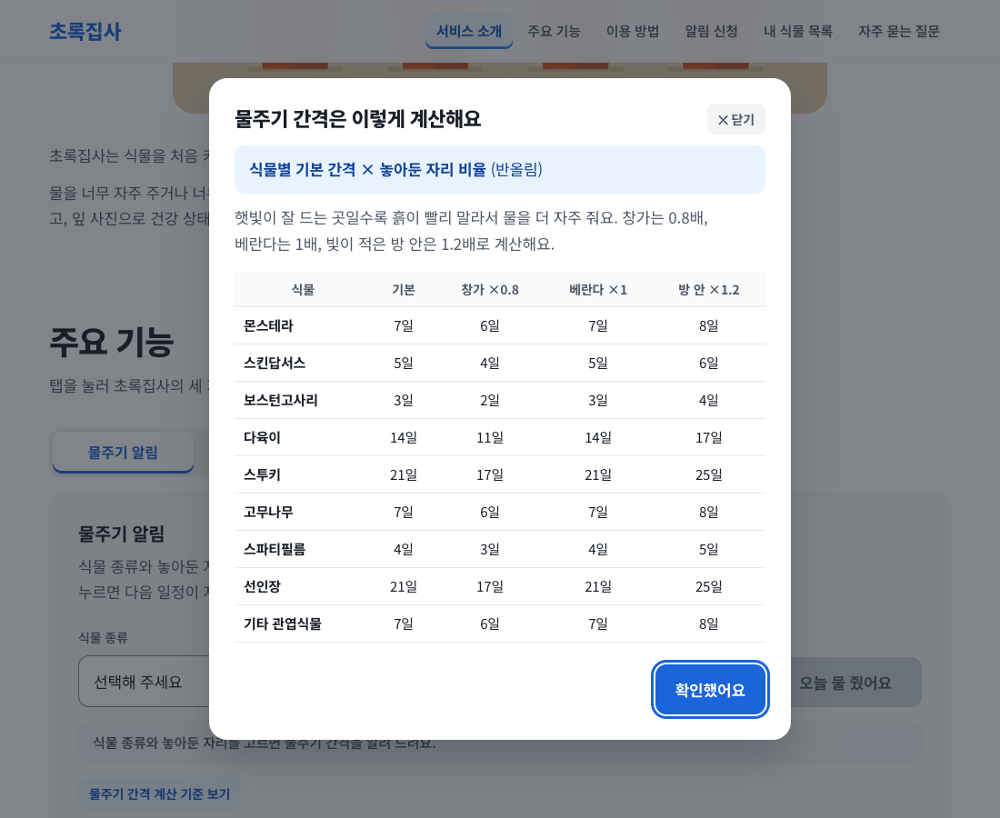 | 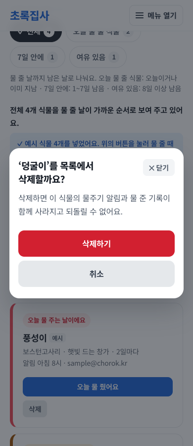 |

| 삭제 취소 후 안내와 초점 복귀 (1100px) |
| --- |
| 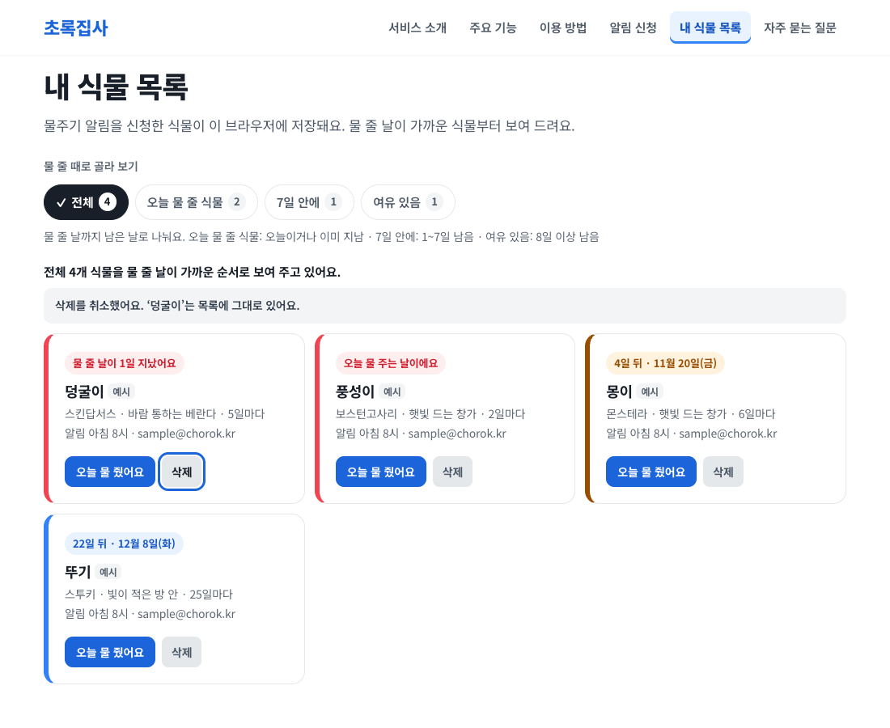 |

| 아코디언: 2개 펼침, 두 번째 질문에 초점 (1100px) | 아코디언 모두 펼침 (390px) |
| --- | --- |
| 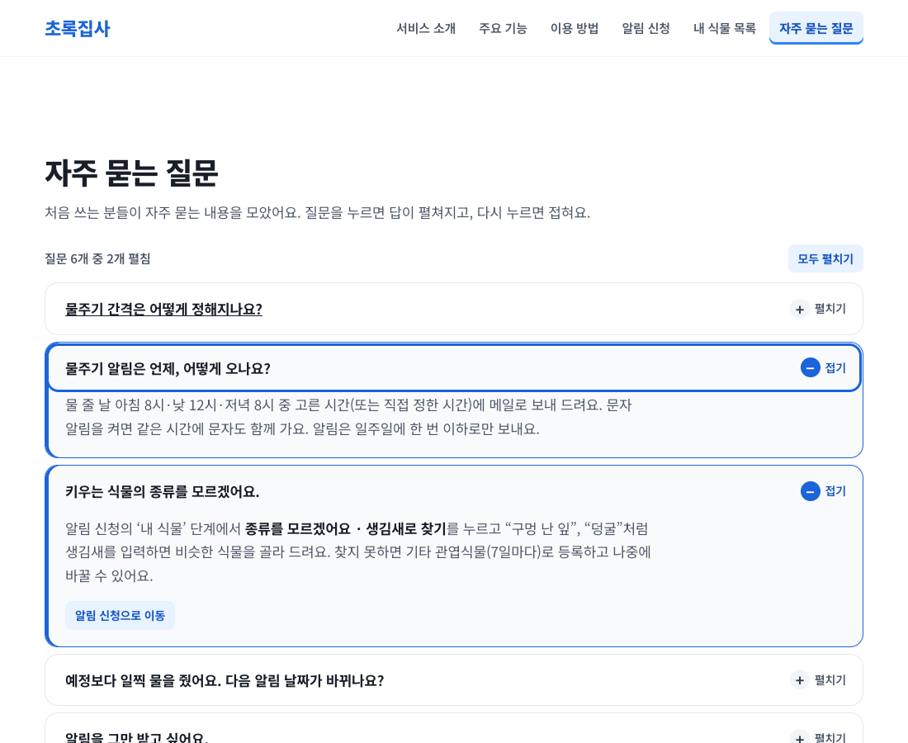 | 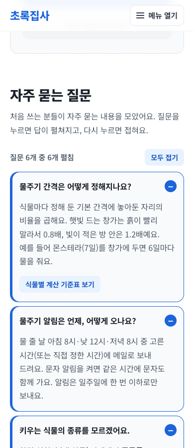 |

## 11주차: 웹 접근성 개선

시력이 약한 사용자, 색을 구분하기 어려운 사용자, 마우스 없이 키보드나 화면 낭독기로 이용하는 사용자도 정보를 이해하고 물주기 알림을 신청할 수 있도록 색·문구·키보드 조작을 고쳤습니다.

### 점검 방법

1. **자동 검사**: axe-core(WCAG 2.2 AA와 권장 규칙)를 1100px·390px에서 29가지 화면 상태마다 돌렸습니다. 처음 화면, 각 탭, 오류 안내, 식물 찾기, 신청 중, 완료, 신청 실패, 목록 없음, 필터 결과 없음, 모바일 메뉴 등을 포함합니다.
2. **키보드 점검**: 맨 위에서부터 Tab으로 끝까지 이동하며 확인했습니다. 초점 표시가 보이는지, 고정된 상단 바에 가려지지 않는지, 순서가 자연스러운지 봤습니다.
3. **키보드만으로 핵심 과업**: 마우스 없이 신청을 끝까지 진행해 봤습니다. 순서는 본문 바로가기 → 메뉴 → 탭 → 신청(찾기·오류 수정·조건부 칸·동의) → 완료 → 목록·필터입니다.
4. **대비 계산**: 바꾸기 전후 색 조합의 명도 대비를 계산했습니다.

### 개선 전 → 개선 후

| 구분 | 개선 전 | 개선 후 |
| --- | --- | --- |
| 색 대비: 버튼 | 파란 버튼(#3182f6)의 흰 글씨 대비가 **3.71:1**로 기준(4.5:1) 미달 | 버튼 색을 #1b64da로 진하게 바꿔 **5.41:1** (`알림 신청하기`, `다음`, `물주기 알림 받기`, `이 식물로 선택` 등 모든 파란 버튼) |
| 색 대비: 회색 글씨 | 도움말·라벨·진행 단계·탭 글자가 회색 배경 위에서 **4.19:1**. 글자 수·푸터·안내 문구는 **2.76~3.04:1** | 보조 회색을 #5c6572로 진하게 바꾸고 연한 회색 글씨를 없애 **5.35~6.45:1**. 자동 검사의 대비 오류 **58곳 → 0곳** |
| 입력칸 경계 | 입력칸 테두리 대비 **1.23:1**이라 칸의 경계가 잘 안 보임 | 테두리를 #7e8794로 바꿔 **3.63:1** (입력 요소 기준 3:1 이상) |
| 색만으로 구분하던 상태 | 놓아둔 자리·알림 시간·잎 상태에서 고른 버튼이 파란 색으로만 표시됨. 진단 결과의 심각도가 빨강·주황·파랑 색으로만 구분됨. 오류 문구에 기호 없음 | 고른 버튼 앞에 **✓**를 붙임. 진단 결과 앞에 **"바로 조치 필요 · / 주의 · / 건강 ·"** 문구를 붙임. 오류·경고 문구 앞에 **⚠**, 성공 문구 앞에 **✓**를 붙임. 선택된 탭에 아래 막대 추가. 화면 낭독기는 기호 대신 "오류:", "주의:", "완료," 로 읽음 |
| 초점 표시 | 반투명 연파랑 테두리라 흰 배경에서 대비 **1.63:1**. 입력칸은 테두리 색만 바뀜 | 모든 버튼·링크·입력칸에 진한 파랑(#1b64da) **3px 테두리**를 띄워 표시(**5.41:1**). 오류가 있는 칸은 빨간 테두리. 선택된 필터(검은 배경)와 초점(파란 테두리)도 구분됨 |
| 본문 바로가기 | 키보드 사용자가 매번 로고·메뉴 6개를 지나야 본문에 도착 | 첫 Tab에 `본문 바로가기` 링크가 나타나고, Enter를 누르면 본문(main)으로 바로 이동 |
| 탭 키보드 조작 | 탭 3개가 모두 Tab 순서에 들어가고, 방향키로는 이동할 수 없음 | 선택된 탭만 Tab으로 들어가고(`tabindex` 0/-1), **← → Home End** 키로 탭을 옮기면 내용도 바로 바뀜 |
| 초점이 사라지는 문제 | `오늘 물 줬어요`를 Enter로 누르면 버튼이 비활성화되면서 초점이 사라져 처음부터 다시 Tab해야 함(390px에서 확인). 누른 뒤 비활성화되는 `일지에 기록하기`·`알림 신청하기`도 같은 구조 | 각각 결과 문구, 메모 칸, "신청 내용을 보내는 중" 안내로 초점을 옮겨 그 자리에서 이어서 조작할 수 있음 |
| 버튼 이름 | 확인 화면의 `수정` 버튼 2개가 같은 이름이었고, `닫기`가 무엇을 닫는지 모호함. 필터는 "오늘 물 줄 식물 2"처럼 숫자만 읽힘 | 각각 "내 식물 정보 수정", "알림 받기 정보 수정", "생김새로 찾기 닫기"로 이름을 붙임. 필터는 "오늘 물 줄 식물 2개"로 읽힘. 로고 링크는 "초록집사 처음 화면으로" |
| 움직임 | 부드러운 스크롤과 전환 효과가 항상 켜져 있음 | 기기에서 "동작 줄이기"를 켠 사용자에게는 부드러운 스크롤과 전환 효과를 끔(`prefers-reduced-motion`) |

이미 갖춰져 있어 점검만 한 것:
- 이미지 대체 텍스트: 서비스 소개 그림 1장에 내용을 설명하는 alt가 있습니다.
- 라벨 연결: 모든 입력칸·선택창에 `label`이, 라디오 묶음에 `legend`가, 도움말에 `aria-describedby`가 연결돼 있습니다(9주차).
- 제목 구조: h1 → h2 → h3 → h4 순서로 건너뛰는 단계가 없습니다.
- 안내 메시지: 오류 문구가 "문제 + 고치는 방법"으로 쓰여 있습니다(예: "이메일 주소 형식을 확인해 주세요. 예: green@example.com").

### 키보드로 이용하는 방법

| 키 | 동작 |
| --- | --- |
| Tab / Shift+Tab | 다음 / 이전 요소로 이동 (첫 Tab은 `본문 바로가기`) |
| Enter | 링크 이동, 버튼 누르기, 신청 단계의 `다음` (입력칸에서 눌러도 됨) |
| Space | 체크박스·라디오 선택, 버튼 누르기 |
| ← → / Home End | 주요 기능 탭 이동, 라디오 묶음 안에서 선택 바꾸기 |
| Esc | 모바일에서 펼친 메뉴 닫기 (초점은 메뉴 버튼으로 돌아감) |

### 11주차 테스트 결과

| 확인 항목 | 1100px | 390px |
| --- | :---: | :---: |
| axe-core 자동 검사 (29개 화면 상태) | 위반 0건 (개선 전: 색 대비 58곳) | 위반 0건 |
| Tab으로 끝까지 이동: 모든 정지 위치에 진한 초점 표시, 상단 바에 가려짐 없음 | 통과 (24곳) | 통과 (20곳) |
| 첫 Tab → 본문 바로가기 → Enter로 본문 이동 | 통과 | 통과 |
| 모바일 메뉴: Enter로 열기 → Tab으로 항목 이동 → Esc로 닫기(초점 복귀) → Enter로 이동하며 닫기 | - | 통과 |
| 탭: Tab 한 번으로 들어가기, ← → Home End로 이동·내용 전환, Shift+Tab으로 돌아오기 | 통과 | 통과 |
| 잎 상태 방향키 선택 → "주의 · …" 결과 | 통과 | 통과 |
| 키보드만으로 신청 완료 (찾기 → 결과 선택 → 자리 Space → 오류 후 수정 → 문자 알림 Space → 번호 입력 → 동의 → 신청 → 완료 → 목록 → 필터) | 통과 | 통과 |
| 버튼이 비활성화된 뒤 초점이 결과 문구·메모 칸·진행 안내로 이동 | 통과 | 통과 |
| 기존 기능 다시 확인 (메뉴 현재 위치·뒤로 가기, 목록·필터, 신청 폼 검사·조건부 칸·실패 후 다시 신청, 탭, 생김새로 찾기) — 768px·320px 포함 4개 너비 | 통과 | 통과 |
| 콘솔 JavaScript 오류 | 없음 | 없음 |

- 테스트는 Chrome을 스크립트(Puppeteer)로 조작해 실제 키 입력으로 진행했습니다.
- 선택창(`select`)은 브라우저 기본 기능으로 키보드 조작이 됩니다(Space나 방향키로 목록 열기). 다만 테스트용 헤드리스 Chrome(macOS)은 선택 목록을 띄우지 않아서, 초점이 있는 선택창의 값만 스크립트로 지정했습니다.

| 본문 바로가기 (1100px) |
| --- |
|  |

| 탭 선택 막대와 ✓ 선택 표시, 심각도 문구 (1100px) | 오류 앞 ⚠ 기호와 오류 칸 초점 (1100px) |
| --- | --- |
| 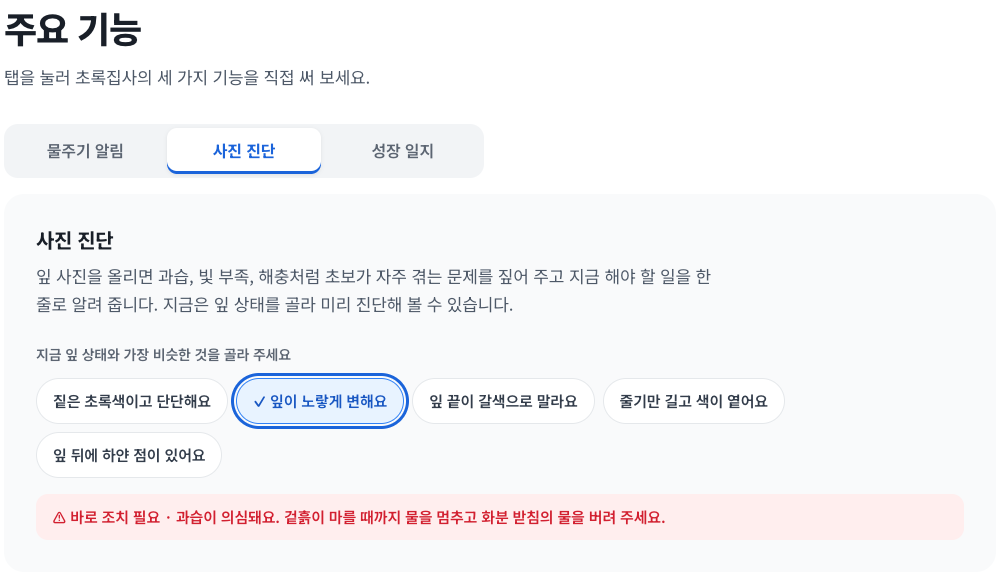 | 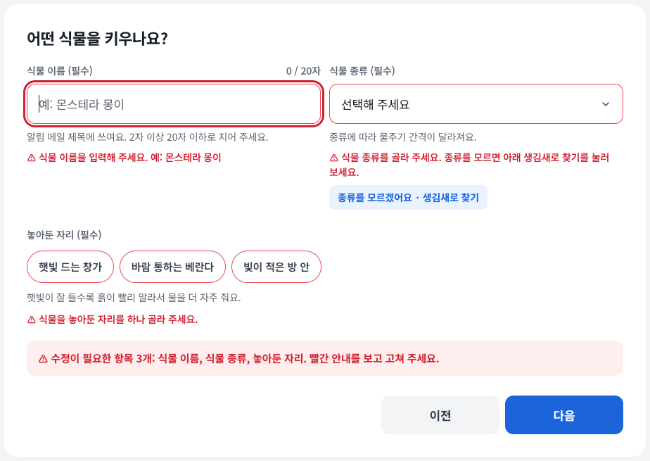 |

| 선택된 필터와 초점이 있는 필터 구분 (1100px) | 모바일 메뉴의 초점 표시 (390px) |
| --- | --- |
| 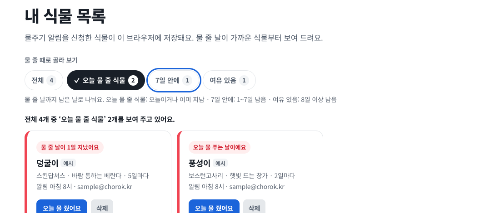 | 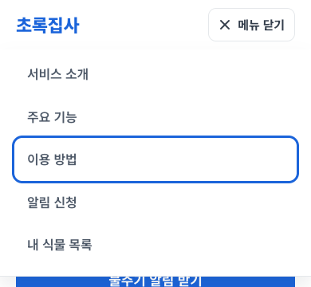 |

## 10주차: 메뉴 이동과 내 식물 목록

어디에 있는지 메뉴에서 바로 알 수 있게 했고, 알림을 신청한 식물을 물 줄 때별로 골라 볼 수 있는 `내 식물 목록`을 추가했습니다. 좁은 화면에서는 메뉴 버튼으로 메뉴를 열고 닫습니다.

### 이번 주 추가·수정한 기능

- **상단 메뉴**
  - `nav` 안의 `ul`·`li` 구조로 바꾸고 `내 식물 목록`을 추가해 메뉴를 5개로 만들었습니다.
  - 상단 바가 첫 화면에서만 고정되던 문제를 고쳐, 이제 페이지 어디에서나 화면 위에 보입니다.
  - 메뉴로 이동해도 제목이 상단 바에 가리지 않게 여백(`scroll-margin-top`)을 두었습니다.
- **현재 위치 표시**
  - 화면 위에서 35% 지점을 지난 마지막 영역을 현재 위치로 봅니다. 그 메뉴에만 `aria-current="location"`을 붙이고 다른 메뉴에서는 지웁니다.
  - 현재 메뉴는 파란 배경, 굵은 글씨, 아래쪽 막대(모바일은 왼쪽 막대)로 다른 메뉴와 구분됩니다.
  - 스크롤, 메뉴 이동(`hashchange`), 뒤로·앞으로 가기(`popstate`), 새로고침(`load`·`pageshow`) 때마다 실제 화면을 기준으로 다시 계산합니다. 그래서 표시가 항상 보이는 화면과 같습니다.
  - 맨 위 첫 화면에는 해당하는 메뉴가 없으므로 아무 메뉴도 표시하지 않습니다.
- **모바일 메뉴 (768px 이하)**
  - `메뉴 열기` 버튼을 누르면 메뉴가 상단 바 아래로 펼쳐집니다. 이때 버튼 문구는 `메뉴 닫기`, 아이콘은 ✕, `aria-expanded`는 `true`로 함께 바뀝니다.
  - 메뉴에서 목적지를 고르면 그 위치로 이동하면서 메뉴가 닫힙니다. `Esc` 키나 메뉴 바깥을 눌러도 닫힙니다.
  - 펼친 메뉴는 상단 바 아래에 겹쳐 뜨기 때문에, 열고 닫아도 페이지 배치가 밀리지 않습니다. 처음에는 메뉴가 페이지를 밀어내는 방식이었는데, 그때 브라우저가 스크롤 위치를 보정하면서 뒤로 가기 위치가 어긋나 이 방식으로 바꿨습니다.
  - 넓은 화면에서는 메뉴가 항상 보이고 버튼은 숨겨집니다.
- **내 식물 목록과 필터**
  - 알림 신청이 완료되면 식물이 `localStorage`에 저장되고 목록에 바로 나타납니다. 완료 화면에는 `내 식물 목록 보기` 버튼이 있습니다.
  - 각 식물은 물 줄 날이 가까운 순서로 보여 줍니다. 남은 날은 "물 줄 날이 1일 지났어요" / "오늘 물 주는 날이에요" / "4일 뒤 · 11월 7일(토)"처럼 문구와 색으로 표시합니다.
  - `오늘 물 줬어요`를 누르면 물 준 날을 오늘로 기록해 상태가 바뀌고, `삭제`를 누르면 목록에서 빠집니다.
  - 필터 버튼은 선택 표시(검은 배경과 ✓), `aria-pressed`, 목록 내용, 버튼 옆 개수, "전체 4개 중 ‘7일 안에’ 1개를 보여 주고 있어요." 안내가 함께 바뀝니다.
  - 목록이 비었을 때는 `예시 식물 넣어 보기`로 물 줄 때가 서로 다른 예시 식물 4개를 넣어 필터를 바로 시험할 수 있습니다.
- **신청 흐름 수정**: 한 사람이 식물을 여러 개 등록할 수 있게, 9주차의 "이미 신청함" 기준을 "같은 이메일"에서 "같은 이메일 + 같은 식물 이름"으로 바꿨습니다.

### 메뉴별 목적지

| 메뉴 | 이동하는 곳 | 그곳에서 할 수 있는 일 |
| --- | --- | --- |
| 서비스 소개 | `#about` 서비스 소개 | 초록집사가 어떤 서비스인지 읽기 |
| 주요 기능 | `#features` 주요 기능 탭 | 물주기 계산 · 잎 상태 진단 · 성장 일지 체험 |
| 이용 방법 | `#steps` 이용 방법 | 등록부터 일지까지 5단계 순서 보기 |
| 알림 신청 | `#subscribe` 물주기 알림 신청 | 내 식물을 등록하고 알림 신청하기 (핵심 행동) |
| 내 식물 목록 | `#my-plants` 내 식물 목록 | 신청한 식물을 물 줄 때별로 골라 보고, 물 준 날 기록하기 |

로고 `초록집사`를 누르면 맨 위 첫 화면으로 돌아갑니다.

### 필터 기준

물 줄 날까지 남은 날로 나눕니다. 다음 물 줄 날은 `마지막으로 물 준 날 + 물주기 간격`으로 계산합니다. 신청한 날을 처음 물 준 날로 봅니다.

| 필터 | 기준 | 상태 문구 (색) |
| --- | --- | --- |
| 전체 | 저장된 모든 식물 | - |
| 오늘 물 줄 식물 | 남은 날이 0일 이하 (오늘이거나 이미 지남) | "오늘 물 주는 날이에요" / "물 줄 날이 ○일 지났어요" (빨강) |
| 7일 안에 | 1~7일 남음 | "○일 뒤 · 날짜" (주황) |
| 여유 있음 | 8일 이상 남음 | "○일 뒤 · 날짜" (파랑) |

결과 안내는 두 경우를 구분합니다.

| 상황 | 안내 | 다음 행동 |
| --- | --- | --- |
| 저장된 식물이 하나도 없음 (어떤 필터를 골라도) | "아직 등록한 식물이 없어요." + 요약 "등록한 식물 0개" | `알림 신청하러 가기`, `예시 식물 넣어 보기` |
| 식물은 있지만 고른 필터에 맞는 식물이 없음 | "‘여유 있음’에 해당하는 식물이 없어요. 등록한 식물은 있지만…" + 요약 "전체 3개 중 ‘여유 있음’ 0개…" | `전체 보기` |

코드 위치 ([script.js](script.js), 11주차 코드 기준):
- 현재 위치 계산: `updateCurrentMenu()` 1090줄
- 모바일 메뉴 열고 닫기: `setMenuOpen()` 1122줄, 목적지를 고르면 닫기: `handleMenuClick()` 1133줄
- 필터 묶음 계산: `getPlantStatus()` 1207줄
- 목록·필터 갱신: `renderPlantList()` 1311줄 (결과 안내 구분: 1346줄)
- `오늘 물 줬어요`·`삭제`: `handlePlantAction()` 1379줄

### 조작 순서

1. **메뉴 이동**: 배포 페이지에서 상단 메뉴 `이용 방법`을 누릅니다. 해당 영역으로 이동하고, `이용 방법` 메뉴만 강조됩니다(`aria-current`).
2. **현재 위치 유지 확인**
   - 메뉴를 몇 개 더 누른 뒤 브라우저 뒤로 가기를 누르면, 이전 위치로 돌아가면서 강조도 따라 바뀝니다.
   - 새로고침해도 보이는 영역과 강조된 메뉴가 같습니다.
   - 직접 스크롤해도 강조가 따라 움직입니다.
3. **목록이 없을 때**: `내 식물 목록`으로 이동합니다. "아직 등록한 식물이 없어요." 안내와 `알림 신청하러 가기` 버튼이 보입니다. 이 상태에서 필터를 눌러도 같은 안내가 유지됩니다.
4. **주요 기능 이용**: `알림 신청하러 가기`(또는 메뉴 `알림 신청`)로 이동해 식물을 신청합니다. 예: 보스턴고사리, 햇빛 드는 창가 → 2일마다.
5. **결과 목록 확인**: 완료 화면의 `내 식물 목록 보기`를 누르면, 방금 신청한 식물이 "2일 뒤 · 날짜"로 목록에 나타나고 메뉴 강조는 `내 식물 목록`으로 바뀝니다.
6. **필터 선택**
   - `7일 안에`를 누르면 버튼이 선택 표시(✓)와 `aria-pressed="true"`로 바뀌고, 목록에는 그 식물만 남습니다. 이때 "전체 1개 중 ‘7일 안에’ 1개" 안내가 나옵니다.
   - `여유 있음`을 누르면 "‘여유 있음’에 해당하는 식물이 없어요." 안내와 `전체 보기` 버튼이 나옵니다.
7. **필터를 더 시험하기**
   - 예시 식물을 넣으려면 목록을 비운 상태(`삭제`)에서 `예시 식물 넣어 보기`를 누릅니다. 오늘 물 줄 식물 2개, 7일 안에 1개, 여유 있음 1개가 들어갑니다.
   - `오늘 물 줄 식물`에서 `오늘 물 줬어요`를 누르면 그 식물이 목록에서 빠지고 개수가 줄어듭니다.
8. **모바일 메뉴**: 화면을 768px 이하로 줄이거나 휴대폰에서 엽니다.
   - `메뉴 열기`를 누르면 메뉴가 펼쳐지고 버튼이 `메뉴 닫기`로 바뀝니다.
   - 메뉴를 고르면 그 위치로 이동하고 메뉴가 닫힙니다. `Esc` 키나 메뉴 바깥을 눌러도 닫힙니다.

### 10주차 테스트 결과

Chrome 브라우저를 스크립트(Puppeteer)로 조작해 1100px · 768px · 390px · 320px에서 확인했습니다. 768px 이하는 터치로 조작했습니다.

| 확인 항목 | 1100px | 768px | 390px | 320px |
| --- | :---: | :---: | :---: | :---: |
| 메뉴가 `nav > ul > li` 5개이고 모두 실제 영역과 연결됨 | 통과 | 통과 | 통과 | 통과 |
| 메뉴 5개를 차례로 눌렀을 때 그 메뉴에만 `aria-current`, 실제 보이는 영역과 일치, 제목이 상단 바에 가리지 않음 | 통과 | 통과 | 통과 | 통과 |
| 현재 메뉴가 굵기·배경으로 다른 메뉴와 구분됨 | 통과 | 통과 | 통과 | 통과 |
| 뒤로 가기 2번·앞으로 가기 1번 뒤에도 표시와 실제 화면 일치 | 통과 | 통과 | 통과 | 통과 |
| 새로고침, 직접 스크롤, 맨 위로 돌아오기(표시 해제) | 통과 | 통과 | 통과 | 통과 |
| 넓은 화면: 메뉴 항상 표시, 열기 버튼 숨김 | 통과 | - | - | - |
| 좁은 화면: 열기/닫기 시 표시 상태·버튼 문구·`aria-expanded` 함께 변경, Esc·바깥 누르기로 닫기 | - | 통과 | 통과 | 통과 |
| 좁은 화면: 메뉴에서 목적지를 고르면 이동하고 메뉴 닫힘 | - | 통과 | 통과 | 통과 |
| 화면 너비를 넓혔다 좁혀도 메뉴 상태가 맞음 | - | 통과 | 통과 | 통과 |
| 목록이 없을 때 "전체 목록 없음" 안내 (필터를 골라도 유지) | 통과 | 통과 | 통과 | 통과 |
| 예시 식물 4개, 물 줄 날 순서, 필터별 개수 (4 · 2 · 1 · 1) | 통과 | 통과 | 통과 | 통과 |
| 필터 3개 선택 시 버튼 선택 표시·`aria-pressed`·목록·안내가 함께 바뀜 | 통과 | 통과 | 통과 | 통과 |
| `오늘 물 줬어요` → 상태와 개수 갱신, 필터에서 빠짐 → "조건에 맞는 결과 없음" 안내, `전체 보기`로 복귀 | 통과 | 통과 | 통과 | 통과 |
| 새로고침해도 목록 유지, 모두 삭제하면 "전체 목록 없음"으로 돌아감 | 통과 | 통과 | 통과 | 통과 |
| 메뉴 이동 → 알림 신청 → `내 식물 목록 보기` → 목록에 새 식물 → 필터 선택 | 통과 | 통과 | 통과 | 통과 |
| 같은 이메일로 다른 식물 추가 신청 가능, 같은 이름은 실패 안내 후 고치러 가기 | 통과 | 통과 | 통과 | 통과 |
| 기존 기능: 탭 전환, 물주기 계산, 빈 값 제출 차단, 생김새로 찾기 | 통과 | 통과 | 통과 | 통과 |
| 기존 9주차 폼: 글자 수, 문자 알림 조건부 칸, 직접 정한 시간, 제출 중 상태, 오프라인 실패 후 다시 신청, 초기화 | 통과 | - | 통과 | - |
| 화면 넘침 · 잘림 · 버튼 겹침 없음 | 통과 | 통과 | 통과 | 통과 |
| 콘솔 JavaScript 오류 | 없음 | 없음 | 없음 | 없음 |

| 현재 위치와 필터 (1100px) | 모바일 메뉴 열림 (390px) |
| --- | --- |
| 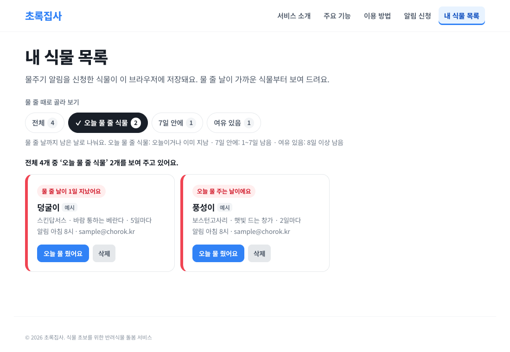 | 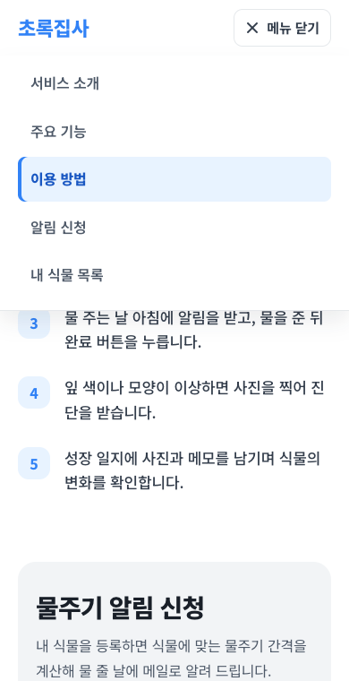 |

| 전체 목록 없음 (390px) | 조건에 맞는 결과 없음 (390px) |
| --- | --- |
| 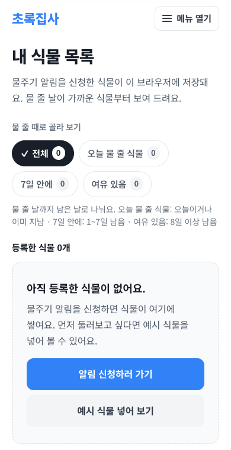 | 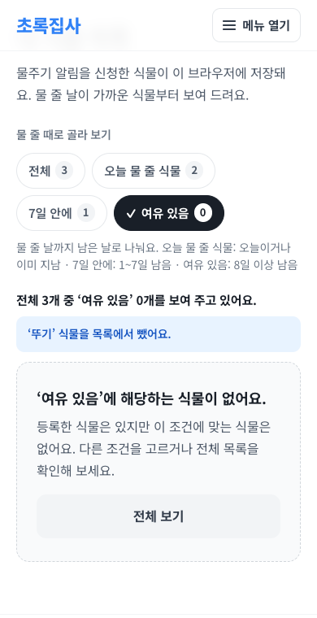 |

## 9주차: 물주기 알림 신청 폼 개선

핵심 행동인 `물주기 알림 신청` 폼을 다듬어, 무엇을 입력해야 하는지 알고 잘못 입력한 값을 고쳐 신청을 끝낼 수 있게 했습니다.

### 이번 주 추가·수정한 기능

- **도움말과 label 연결**: 모든 입력·선택 항목에 `(필수)`·`(선택)` 표시와 입력 조건을 알려 주는 도움말을 달았습니다. 입력칸은 `label`(라디오 묶음은 `legend`)로 이름을 연결하고, 도움말·입력 중 표시·오류 문구는 `aria-describedby`로 연결했습니다.
- **선택에 따른 조건부 입력 (2곳)**
  - `문자(SMS)로도 알림 받기` 체크박스를 켜면 `휴대폰 번호` 칸이 나타납니다.
  - `알림 받을 시간`에서 `직접 정하기` 라디오를 고르면 `원하는 알림 시간` 칸이 나타납니다.
  - 숨겨진 칸은 `hidden`과 `disabled`로 입력·검사·신청 내용에서 빠지고, 표시돼 있던 오류도 지워집니다. 다시 나타나면 입력할 수 있고, 전에 입력한 값은 그대로 남아 있습니다.
- **입력하는 동안 상태 표시 (색과 문구를 함께 사용)**
  - 식물 이름: "1 / 20자 · 1자 더 필요"(주황) → "5 / 20자 · 조건 충족"(파랑) → "23 / 20자 · 3자 초과"(빨강)
  - 이메일: "확인 중: 아직 이메일 형식이 아니에요…" → "✓ 올바른 이메일 형식이에요."
  - 휴대폰 번호: 숫자만 입력하면 `-`가 자동으로 붙고, "확인 중: 지금 7자리 · 4자리 더 입력해 주세요." → "✓ 휴대폰 번호 11자리를 확인했어요."
- **오류 안내와 해제**
  - `다음`을 누를 때, 그리고 값을 입력한 칸에서 벗어날 때 검사합니다.
  - 한 번 검사한 항목은 입력하는 대로 다시 검사하므로, 올바르게 고치면 오류가 바로 사라집니다.
  - 오류마다 문제와 고치는 방법을 함께 알려 줍니다. 단계 아래에는 "수정이 필요한 항목 2개: 휴대폰 번호, 알림 받을 시간"처럼 고칠 항목을 모아 보여 주고, 첫 번째 항목으로 커서를 옮깁니다.
- **제출 처리**
  - `form`의 `submit` 이벤트로 처리합니다. 조건을 충족하지 못하면 다음 단계로 넘어가지 않습니다.
  - `알림 신청하기`를 누르면 1.5초 동안 "신청 내용을 보내는 중이에요."와 함께 버튼이 `신청하는 중…`으로 바뀌고 비활성화됩니다. `이전`·`수정`·수신 동의도 이때는 누를 수 없어, 여러 번 눌러도 한 번만 신청됩니다.
  - 성공하면 신청 기록을 브라우저 `localStorage`(`chorok-signups`)에 저장하고 완료 화면을 보여 줍니다.
  - 실패하면 입력 내용은 그대로 두고, 버튼이 `다시 신청하기`로 바뀌어 다시 시도할 수 있습니다.
- **다시 신청**: `처음부터 다시 신청하기`를 누르면 입력값, 글자 수·확인 문구, 오류와 안내, 조건부 칸, 버튼 문구, 진행 표시가 모두 처음으로 돌아갑니다. 저장된 신청 기록은 지우지 않습니다.

### 입력 조건

| 항목 | 입력 요소 | 조건 | 조건을 못 지켰을 때 안내 (예) |
| --- | --- | --- | --- |
| 식물 이름 | 텍스트 | 필수, 앞뒤 공백을 뺀 2자 이상 20자 이하 | "식물 이름이 너무 짧아요. 2자 이상으로 입력해 주세요." / "식물 이름이 3자 넘쳐요. 20자 이하로 줄여 주세요." |
| 식물 종류 | 선택창 | 필수 | "식물 종류를 골라 주세요. 종류를 모르면 아래 생김새로 찾기를 눌러 보세요." |
| 놓아둔 자리 | 라디오 | 필수 | "식물을 놓아둔 자리를 하나 골라 주세요." |
| 이메일 주소 | 이메일 | 필수, 이메일 형식이고 @ 뒤 도메인에 점(.)이 있음 | "이메일 주소 형식을 확인해 주세요. 예: green@example.com" |
| 문자 알림 | 체크박스 | 선택 | - |
| 휴대폰 번호 | 전화번호 (문자 알림을 켰을 때만) | 010으로 시작하는 11자리 | "010으로 시작하는 11자리 번호를 입력해 주세요. 예: 010-1234-5678" |
| 알림 받을 시간 | 라디오 | 필수 | "알림 받을 시간을 하나 골라 주세요." |
| 원하는 알림 시간 | 시간 (`직접 정하기`를 골랐을 때만) | 오전 6시 ~ 밤 10시 | "이른 새벽이나 늦은 밤은 피해 주세요. 오전 6시부터 밤 10시 사이로 정해 주세요." |
| 수신 동의 | 체크박스 | 필수 | "알림을 받으려면 수신 동의에 체크해 주세요." |

검사 규칙은 [script.js](script.js)의 `validators`(337줄)에 항목별로 모여 있습니다.

### 제출 결과와 실패 처리

서버 없이 `finishSignup()`([script.js](script.js) 700줄)에서 결과를 정합니다. (줄 번호는 11주차 코드 기준)

| 결과 | 조건 | 화면 | 코드 |
| --- | --- | --- | --- |
| 실패 1 | 인터넷 연결이 끊김 (`navigator.onLine`이 `false`) | "인터넷에 연결되어 있지 않아 신청하지 못했어요. 입력한 내용은 그대로 있어요…" | `finishSignup()` 705줄 |
| 실패 2 | 같은 이메일로 같은 이름의 식물을 이 브라우저에서 이미 신청함 (10주차에 "같은 이메일"에서 바꿈) | "‘몽이’ 식물은 이 이메일로 이미 알림을 신청했어요…" + `식물 이름·이메일 고치러 가기` 버튼 | `finishSignup()` 716줄, `isRegistered()` 629줄 |
| 실패 3 | `localStorage`에 저장할 수 없음 (저장소 차단·용량 부족) | "신청 내용을 저장하지 못했어요. 입력한 내용은 그대로 있어요…" | `finishSignup()` 727줄, `saveSignup()` 645줄 |
| 성공 | 위 실패에 해당하지 않음 | 신청 기록을 저장하고 완료 화면에 첫 알림 날짜·시간·받을 곳 표시 | `finishSignup()` |

- 실패하면 입력값은 그대로 남고, 버튼이 `다시 신청하기`로 바뀌어 바로 다시 시도할 수 있습니다.
- 제출 중 상태(버튼 비활성·진행 문구)는 `setSubmitting()`(665줄)이 담당합니다. 중복 제출은 `handleFlowSubmit()`(764줄)의 `isSubmitting` 검사로도 한 번 더 막습니다.
- 저장된 신청 기록을 지우려면 개발자 도구 → Application → Local Storage에서 `chorok-signups`를 삭제합니다.

### 확인 순서

1. 배포 페이지 맨 아래 `물주기 알림 신청`에서 `등록 시작하기`를 누릅니다.
2. **빈 값 제출**: 아무것도 입력하지 않고 `다음`을 누릅니다. 세 항목에 빨간 안내와 "수정이 필요한 항목 3개" 안내가 나오고, 다음 단계로 넘어가지 않습니다.
3. **잘못된 값과 입력 중 표시**: 식물 이름에 `몽`을 입력하면 "1자 더 필요"와 오류가 나옵니다. `몽이`로 고치면 "조건 충족"으로 바뀌고 오류가 사라집니다. 20자를 넘게 입력하면 "○자 초과"가 표시됩니다.
4. 식물 이름은 2~20자로 맞추고, 종류와 자리를 고른 뒤 `다음`을 누릅니다.
5. **오류 수정**: 이메일에 `green@exa`를 입력하고 다른 칸을 누르면 형식 오류가 나옵니다. 이어서 `mple.com`을 입력하면 오류가 사라지고 "✓ 올바른 이메일 형식이에요."가 나옵니다.
6. **조건부 영역 (체크박스)**
   - `문자(SMS)로도 알림 받기`를 체크하면 휴대폰 번호 칸이 나타납니다.
   - 번호 없이 `다음`을 누르면 오류가 나옵니다. `01012345678`을 입력하면 `010-1234-5678`로 바뀌고 ✓가 표시됩니다.
   - 체크를 풀면 번호 칸이 사라지고 입력할 수 없게 됩니다. 다시 체크하면 입력했던 번호가 그대로 있습니다.
7. **조건부 영역 (라디오)**: `직접 정하기`를 고르면 시간 칸이 나타납니다. `오후 11:30`으로 `다음`을 누르면 시간 범위 오류가 나오고, `오전 7:30`으로 고치면 사라집니다. 다른 시간을 고르면 시간 칸이 사라집니다.
8. **정상 제출**
   - `다음`을 누르면 확인 화면에 문자 알림 번호와 `오전 7시 30분`이 반영돼 있습니다.
   - 수신 동의 없이 `알림 신청하기`를 누르면 안내가 나옵니다.
   - 동의하고 다시 누르면 약 1.5초 동안 `신청하는 중…` 상태(버튼 비활성)가 된 뒤 완료 화면이 나옵니다.
9. **다시 작성**: `처음부터 다시 신청하기` → `등록 시작하기`를 누르면 입력값, 글자 수, 안내 문구, 체크와 조건부 칸, 버튼 문구가 모두 처음 상태로 돌아갑니다.
10. **실패와 다시 시도**
    - 방금 신청한 것과 같은 이메일·같은 식물 이름으로 한 번 더 신청하면, 입력 내용은 그대로 둔 채 "‘○○’ 식물은 이 이메일로 이미 알림을 신청했어요" 안내와 `다시 신청하기` 버튼이 나옵니다.
    - `식물 이름·이메일 고치러 가기`로 이름이나 이메일을 바꾼 뒤 다시 신청하면 성공합니다.
11. (선택) 개발자 도구 Network에서 `Offline`으로 바꾸고 신청하면 연결 실패 안내가 나옵니다. 다시 `No throttling`으로 바꾸고 `다시 신청하기`를 누르면 성공합니다.

### 9주차 테스트 결과

Chrome 브라우저를 스크립트(Puppeteer)로 조작해 1100px · 768px · 390px · 320px에서 위 확인 순서를 실행했습니다. 실제 클릭 · 터치 · 키 입력을 사용했고, 390px과 320px은 모바일 터치로 조작했습니다.

| 확인 항목 | 1100px | 768px | 390px | 320px |
| --- | :---: | :---: | :---: | :---: |
| 모든 입력에 label과 도움말이 연결됨 (`aria-describedby` 대상이 실제로 있음) | 통과 | 통과 | 통과 | 통과 |
| 빈 값 제출 → 차단, 항목별 오류와 "수정이 필요한 항목 3개" 안내 | 통과 | 통과 | 통과 | 통과 |
| 식물 이름 글자 수: 1자 더 필요 → 조건 충족 → ○자 초과 (문구와 색) | 통과 | 통과 | 통과 | 통과 |
| 이메일: 입력 중 확인 문구, 칸을 벗어나면 오류, 고치면 바로 해제와 ✓ | 통과 | 통과 | 통과 | 통과 |
| 문자 알림 체크/해제 → 번호 칸 표시·숨김과 `disabled` 전환, 다시 켜면 값 유지 | 통과 | 통과 | 통과 | 통과 |
| 휴대폰 번호 자동 하이픈, 자리 수 표시, 11자리 오류와 해제 | 통과 | 통과 | 통과 | 통과 |
| 직접 정하기 → 시간 칸 표시와 `disabled` 전환, 범위 밖 시간 차단과 해제 | 통과 | 통과 | 통과 | 통과 |
| 확인 화면에 번호·직접 정한 시간 반영 | 통과 | 통과 | 통과 | 통과 |
| 수신 동의 없이 제출 → 차단과 안내 | 통과 | 통과 | 통과 | 통과 |
| 제출 중 진행 문구·버튼 비활성, 연속 제출해도 저장은 1건 | 통과 | 통과 | 통과 | 통과 |
| 성공 → 완료 안내 (이메일과 문자 번호 포함) | 통과 | 통과 | 통과 | 통과 |
| 처음부터 다시 신청 → 입력값·안내·버튼 상태 초기화 | 통과 | 통과 | 통과 | 통과 |
| 실패(이미 신청함) → 입력 유지, 바꿔서 다시 신청 → 성공 (9주차 기준. 10주차 기준 변경 후 다시 확인함) | 통과 | 통과 | 통과 | 통과 |
| 실패(오프라인) → 입력 유지, 연결 후 다시 신청 → 성공 | 통과 | 통과 | 통과 | 통과 |
| 실패(저장 불가) → 입력 유지, 다시 신청 → 성공 | 통과 | 통과 | 통과 | 통과 |
| 모든 상태에서 가로 넘침 · 잘림 · 버튼과 입력칸 겹침 없음 | 통과 | 통과 | 통과 | 통과 |
| 기존 기능 다시 확인: 탭 3개, 생김새로 찾기, 이전·수정, 진행 표시 | 통과 | 통과 | 통과 | 통과 |
| 콘솔 JavaScript 오류 | 없음 | 없음 | 없음 | 없음 |

| 조건부 입력과 오류 안내 (1100px) | 글자 수 초과 (390px) |
| --- | --- |
| 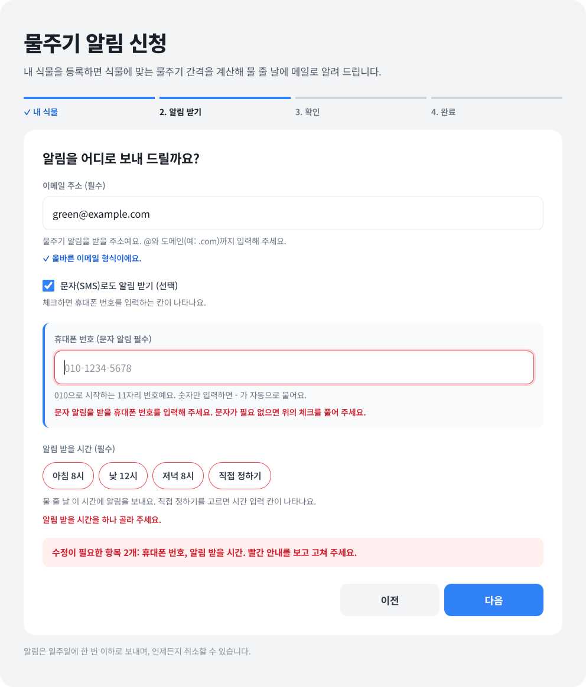 | 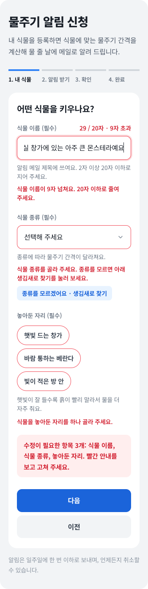 |

| 제출 중 (1100px) | 실패 후 다시 시도 (390px) |
| --- | --- |
| 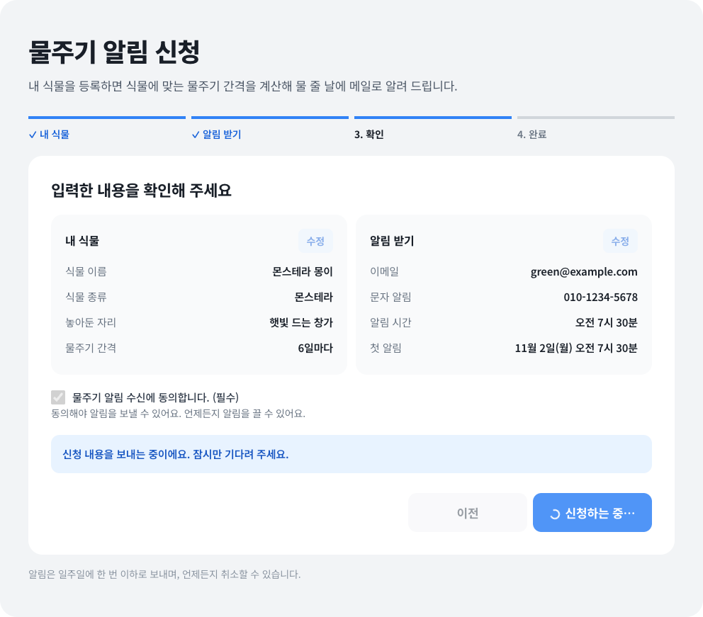 | 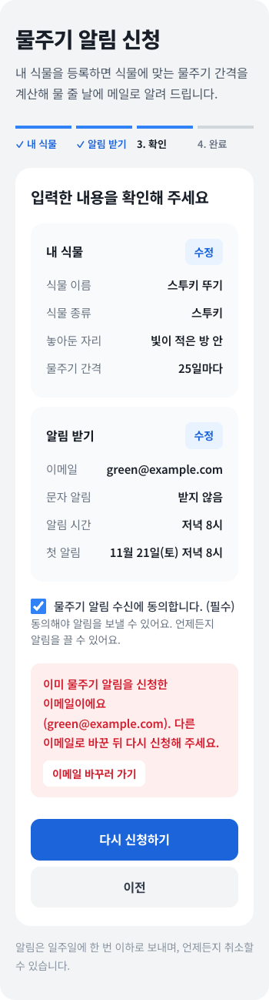 |

## 중간고사 추가 기능: 생김새로 식물 찾기

7주차 신청 흐름의 2단계(내 식물)에 **식물 종류를 모를 때 잎·줄기 생김새로 찾아 바로 고르는 경로**를 추가했습니다. "구멍 난 잎", "덩굴"처럼 생김새나 식물 이름을 입력하면 맞는 식물 목록이 나오고, 고른 식물이 신청 흐름의 식물 종류와 확인 화면에 반영됩니다.

- **사용자·목표와의 연결**: 주요 사용자인 식물 초보는 선물 받거나 사 온 식물의 종류 이름을 모르는 경우가 많습니다. 7주차 흐름에서는 종류를 모르면 2단계에서 막혀 목표(물주기 알림 받기)를 끝낼 수 없었습니다. 물주기 간격도 종류에 따라 달라지므로, 종류를 제대로 고르게 돕는 것이 알림의 정확도와도 이어집니다.
- **흐름과 연결한 지점**: 흐름의 중간인 2단계(내 식물)입니다. `식물 종류` 선택창 아래 `종류를 모르겠어요 · 생김새로 찾기` 버튼에서 시작합니다. 종류를 고르지 않고 `다음`을 누르면 나오는 오류 안내("종류를 모르면 아래 생김새로 찾기를 눌러 보세요.")도 이 기능으로 안내합니다.
- **입력과 버튼**: `식물 이름이나 잎·줄기 생김새` 검색창, 예시 검색어 버튼 5개(구멍 난 잎 · 덩굴 · 통통한 잎 · 하얀 꽃 · 가시), `찾기`, `이 식물로 선택`, `기타 관엽식물로 등록`(결과 없음일 때), `닫기`
- **찾는 방법**: 띄어쓰기를 무시하고 식물 8종의 이름 · 생김새 설명 · 검색어 목록과 비교합니다. 검색창에서 누른 Enter는 신청 흐름의 다음 단계로 넘어가지 않고 검색만 합니다. 한글을 조합하는 중에 누른 Enter는 무시해서 검색이 두 번 실행되지 않게 했습니다.

### 사용자 행동과 반응

| 사용자 행동 | 이벤트 | 확인할 조건 | 화면 반응 | 다음 행동 |
| --- | --- | --- | --- | --- |
| `종류를 모르겠어요 · 생김새로 찾기` 누름 | `click` | 찾기 영역이 닫혀 있음 | 찾기 영역을 펼치고 검색창에 커서, 버튼은 회색(펼침 상태)으로 바뀜 | 생김새 입력 또는 예시 검색어 누르기 |
| 검색어 입력 후 `찾기` 누름 또는 Enter | `click` / `keydown` | **성공**: 검색어가 있고 맞는 식물이 있음 | "‘구멍 난 잎’ 검색 결과 1개 · 키우는 식물을 골라 주세요."와 결과 카드(이름 · 생김새 · 기본 물주기 간격) 표시 | `이 식물로 선택` |
| 〃 | 〃 | **오류**: 검색어가 비어 있음 | 검색창 빨간 테두리와 "찾을 식물의 이름이나 생김새를 입력해 주세요. 예: 구멍 난 잎", 검색창에 커서 | 생김새 입력 (입력하면 오류 표시가 지워짐) |
| 〃 | 〃 | **결과 없음**: 맞는 식물이 없음 | 주황 글씨 "‘파란 잎’ 검색 결과가 없어요."와 다시 찾는 방법 안내 | 다른 생김새로 다시 찾기 또는 `기타 관엽식물로 등록` |
| 예시 검색어 버튼 누름 | `click` | - | 검색창에 검색어를 넣고 바로 검색 | `이 식물로 선택` |
| `이 식물로 선택` 누름 | `click` | - | 식물 종류 선택창에 반영, 종류 오류 지움, 찾기 영역 닫힘, 파란 글씨 "생김새로 찾은 식물: 스파티필름 · 기본 4일마다 물주기" | 자리를 고르고 `다음` → 확인 화면에 "스파티필름 (생김새로 찾음)"과 계산된 간격 표시 |
| `기타 관엽식물로 등록` 누름 | `click` | 결과 없음 상태 | 종류를 기타 관엽식물로 정하고 "목록에 없는 식물이라 기타 관엽식물(기본 7일마다)로 등록했어요." 안내 | `다음` |
| `닫기` 누름 (또는 찾기 버튼을 한 번 더 누름) | `click` | **취소**: 찾기 영역이 열려 있음 | 찾기 영역 닫힘, 식물 종류는 그대로, "식물 찾기를 닫았어요. 식물 종류는 그대로예요. 목록에서 고르거나 다시 찾아보세요." | 목록에서 직접 고르기 또는 다시 찾기 |
| 찾은 뒤 목록에서 종류를 직접 바꿈 | `change` | - | 찾기 안내를 지우고, 확인 화면의 "(생김새로 찾음)" 표시도 빠짐 | `다음` |
| 찾기를 다시 열거나 `이전`으로 갔다가 돌아옴 | `click` | - | 마지막 검색어와 결과를 그대로 유지 | 이어서 고르기 |
| `처음부터 다시 신청하기` 누름 | `click` | - | 검색어, 결과, 결과 없음 안내, 오류, 찾기 안내를 모두 지우고 찾기 영역을 닫음 | 새로 신청 |

**파일별 역할**
- HTML: 찾기 버튼, 검색창, 예시 검색어, 결과 목록, 결과 없음 안내의 구조를 담당합니다. `hidden`, `aria-expanded`, `aria-live`를 사용합니다.
- CSS: 펼침 상태의 버튼 색, 오류 테두리, 결과 없음의 주황 안내, 결과 카드를 표현하고, 모바일에서는 `이 식물로 선택` 버튼을 전체 너비로 배치합니다.
- JavaScript: 이벤트(`click` · `keydown` · `input` · `change`)를 연결하고, 검색 조건을 판단해 결과 목록을 만들고, 신청 흐름의 식물 종류와 확인 화면에 반영하고, 초기화합니다.

### 중간고사 기능 테스트 결과

Chrome 브라우저를 스크립트(Puppeteer)로 조작해 화면 너비 1100px · 768px · 390px · 320px에서 실제 클릭 · 터치 · 키 입력을 실행하고, 화면에 나타난 문구와 상태를 확인했습니다. 390px과 320px은 모바일 터치로 조작했습니다.

| 경로 | 시험한 내용 | 1100px | 768px | 390px | 320px |
| --- | --- | :---: | :---: | :---: | :---: |
| 정상 | "구멍 난 잎" 입력 후 Enter → 몬스테라 1개, 신청 흐름은 2단계 그대로 | 통과 | 통과 | 통과 | 통과 |
| 정상 | 예시 "하얀 꽃" → 스파티필름 → `이 식물로 선택` → 선택창 반영, 안내 표시, 찾기 닫힘 | 통과 | 통과 | 통과 | 통과 |
| 정상 | 이어서 신청 → 확인 화면에 "스파티필름 (생김새로 찾음)", 창가 기준 3일마다 | 통과 | 통과 | 통과 | 통과 |
| 정상 | 넓은 검색어 "잎" → 결과 7개 목록 | 통과 | 통과 | 통과 | 통과 |
| 오류 | 빈 검색창으로 `찾기` → 안내, 빨간 테두리, 검색창에 커서 / 입력하면 오류 지움 | 통과 | 통과 | 통과 | 통과 |
| 오류 연결 | 종류 없이 `다음` → 종류 오류 안내에서 생김새로 찾기 안내 | 통과 | 통과 | 통과 | 통과 |
| 결과 없음 | "파란 잎" → 결과 없음 안내 → `기타 관엽식물로 등록` → 종류 반영, 종류 오류 지움 | 통과 | 통과 | 통과 | 통과 |
| 취소 | `닫기` → 찾기 닫힘, 종류 그대로, 다음 행동 안내, 찾기 버튼에 커서 | 통과 | 통과 | 통과 | 통과 |
| 수정 | 찾은 뒤 목록에서 직접 변경 → 안내 지움 / 확인 화면 `수정`으로 돌아와 선인장으로 변경 → 확인 화면에 "선인장", 17일마다 | 통과 | 통과 | 통과 | 통과 |
| 값 유지 | 찾기를 다시 열거나 `이전`으로 갔다가 돌아와도 검색어와 결과 유지 | 통과 | 통과 | 통과 | 통과 |
| 초기화 | 신청 완료 후 `처음부터 다시 신청하기` → 찾기 관련 상태 모두 초기화 | 통과 | 통과 | 통과 | 통과 |
| 화면 | 모든 상태에서 가로 넘침 · 잘림 · 버튼과 입력창 겹침 없음 | 통과 | 통과 | 통과 | 통과 |
| 기존 기능 | 7주차 신청 흐름과 주요 기능 탭 다시 확인 (아래 테스트 결과) | 통과 | 통과 | 통과 | 통과 |
| 콘솔 JavaScript 오류 | - | 없음 | 없음 | 없음 | 없음 |

| 검색 결과 (1100px) | 결과 없음 (390px) |
| --- | --- |
| 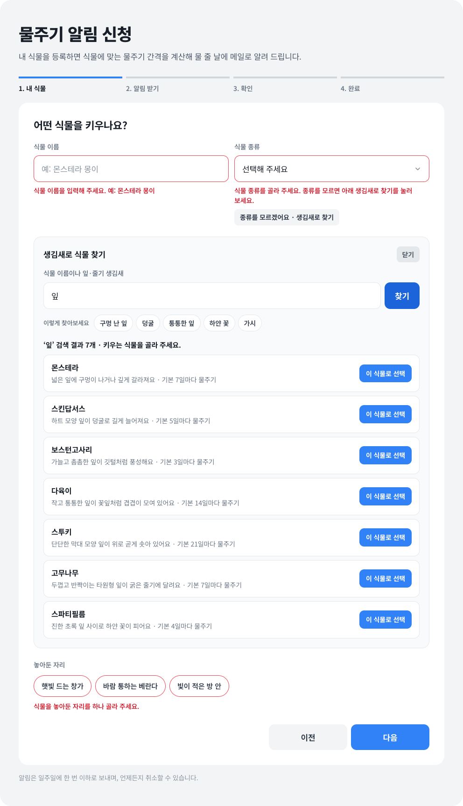 | 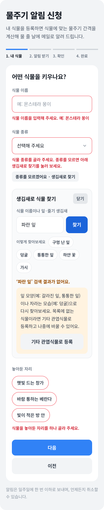 |

| 선택 후 안내 (390px) | 확인 화면 반영 (1100px) |
| --- | --- |
| 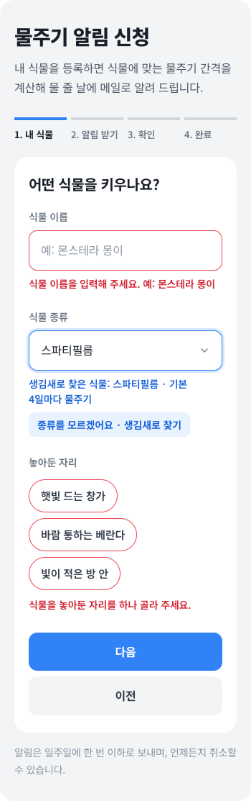 | 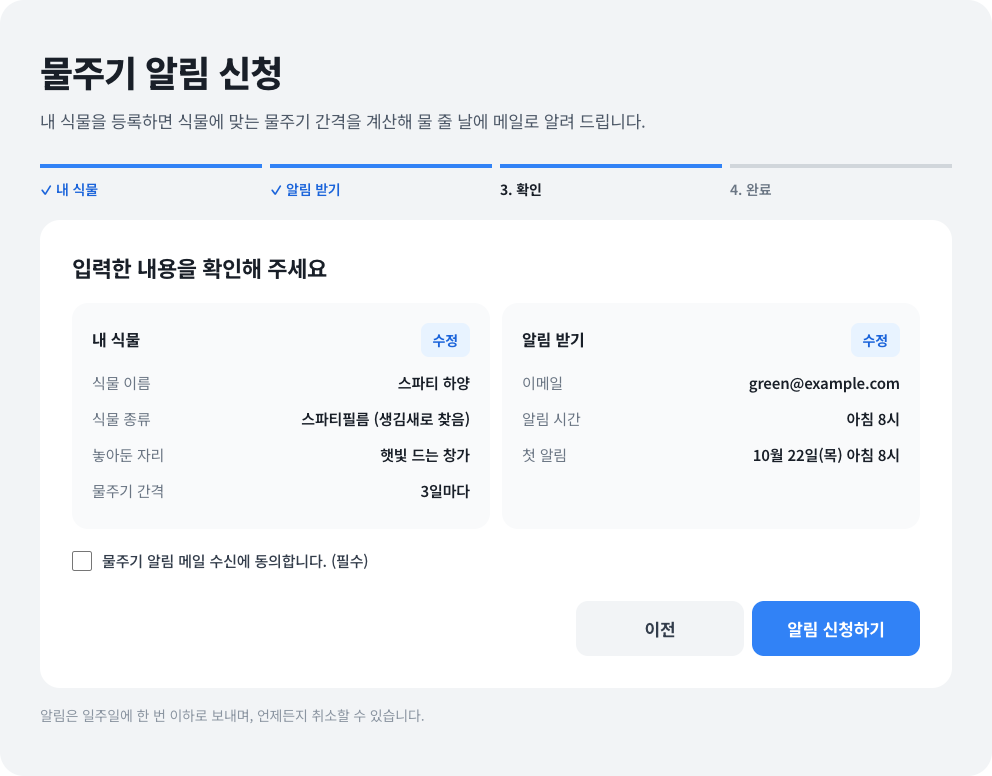 |

## 사용자 흐름: 물주기 알림 신청

페이지 맨 아래 `물주기 알림 신청`에서 시작부터 완료까지 다섯 단계로 진행합니다. 상단 메뉴의 `알림 신청`이나 첫 화면의 `물주기 알림 받기` 버튼으로도 바로 이동할 수 있습니다.

| 단계 | 화면 제목 | 사용자가 하는 일 | 다음 단계로 가는 조건 |
| --- | --- | --- | --- |
| 1. 시작 | 내 식물 등록하고 물주기 알림 받기 | 필요한 정보를 확인하고 `등록 시작하기` | 없음 |
| 2. 내 식물 (입력·선택) | 어떤 식물을 키우나요? | 식물 이름 입력, 식물 종류 선택(모르면 생김새로 찾기), 놓아둔 자리 선택 | 세 항목 모두 입력·선택 |
| 3. 알림 받기 (입력·선택) | 알림을 어디로 보내 드릴까요? | 이메일 입력, 문자 알림 선택(켜면 휴대폰 번호 입력), 알림 받을 시간 선택(직접 정하기를 고르면 시간 입력) | 이메일 형식이 맞고 시간을 고름, 나타난 칸도 조건 충족 |
| 4. 확인 | 입력한 내용을 확인해 주세요 | 입력 내용과 계산된 물주기 간격·첫 알림 날짜 확인, 필요하면 `수정`, 수신 동의 체크 | 수신 동의 체크 |
| 5. 완료 | 물주기 알림 신청 완료 | 결과 확인, 필요하면 `처음부터 다시 신청하기` | - |

- 진행 표시(`1. 내 식물 · 2. 알림 받기 · 3. 확인 · 4. 완료`)는 시작 다음 단계부터 현재 단계를 파란 막대와 굵은 글씨로, 지난 단계를 ✓로 표시합니다. 완료하면 네 칸이 모두 ✓로 바뀝니다.
- 물주기 간격은 `식물별 기본 간격 × 자리별 비율`로 계산합니다. 예를 들어 몬스테라(7일)를 햇빛 드는 창가(0.8)에 두면 6일마다입니다. 주요 기능의 `물주기 알림` 탭과 같은 계산 함수를 사용합니다.

## 인터랙션 시나리오

| 사용자 행동 | 이벤트 | 조건 | 화면 반응 | 다음 상태 |
| --- | --- | --- | --- | --- |
| `등록 시작하기` 누름 | `click` | - | 시작 화면을 숨기고 2단계 표시, 진행 표시 1칸 강조 | 2. 내 식물 |
| 2단계에서 `다음` 누름 또는 Enter | `submit` | 이름·종류·자리가 모두 있음 | 3단계 표시, 진행 표시 1칸 ✓ | 3. 알림 받기 |
| 〃 | `submit` | 하나라도 비어 있음 | 빠진 항목마다 빨간 테두리와 고치는 방법 안내(예: "식물 이름을 입력해 주세요. 예: 몬스테라 몽이"), 첫 번째 빠진 항목으로 커서 이동 | 2단계 유지 |
| 한 번 검사한 항목을 입력·선택 | `input` / `change` | 올바르게 고침 (9주차부터 입력할 때마다 다시 검사) | 그 항목의 빨간 테두리와 안내 문구 지움 | 현재 단계 유지 |
| 3단계에서 `다음` 누름 또는 Enter | `submit` | 이메일 형식이 맞고 시간을 고름 | 입력값으로 확인 화면을 채워 표시 | 4. 확인 |
| 〃 | `submit` | 이메일이 비었거나 형식이 틀림, 또는 시간 미선택 | "이메일 주소 형식을 확인해 주세요. 예: green@example.com", "알림 받을 시간을 하나 골라 주세요." 안내 | 3단계 유지 |
| `이전` 누름 | `click` | - | 바로 앞 단계 표시, 입력·선택한 값은 그대로 | 앞 단계 |
| 확인 화면에서 `수정` 누름 | `click` | - | 해당 단계(내 식물 또는 알림 받기)로 이동, 값 유지 | 2단계 또는 3단계 → 다시 `다음`을 누르면 수정한 값이 확인 화면에 반영 |
| `알림 신청하기` 누름 | `submit` | 수신 동의 체크함 | 1.5초 동안 `신청하는 중…`(버튼 비활성) → 저장에 성공하면 완료 화면에 "○○의 첫 물주기 알림을 11월 6일(금) 저녁 8시에 … 주소로 보내 드릴게요." 표시, 진행 표시 모두 ✓ | 5. 완료 |
| 〃 | `submit` | 같은 이메일·같은 식물 이름으로 이미 신청, 오프라인, 저장 불가 (9주차) | 입력 내용을 유지한 채 실패 이유와 다시 시도 방법 안내, 버튼은 `다시 신청하기` | 4단계 유지 |
| 〃 | `submit` | 수신 동의 안 함 | 체크박스 빨간 테두리와 "알림 메일을 받으려면 수신 동의에 체크해 주세요." 안내 | 4단계 유지 |
| `처음부터 다시 신청하기` 누름 | `click` | - | 모든 입력·선택·동의, 오류 표시, 확인 내용, 진행 표시를 초기화하고 시작 화면 표시 | 1. 시작 |

| 2단계 누락 안내 (390px) | 확인 화면 (1100px) | 완료 화면 (390px) |
| --- | --- | --- |
| 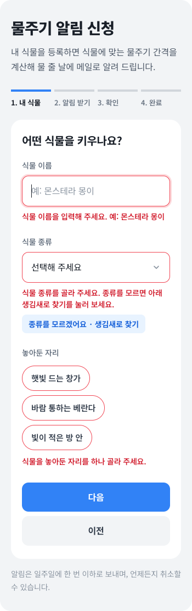 | 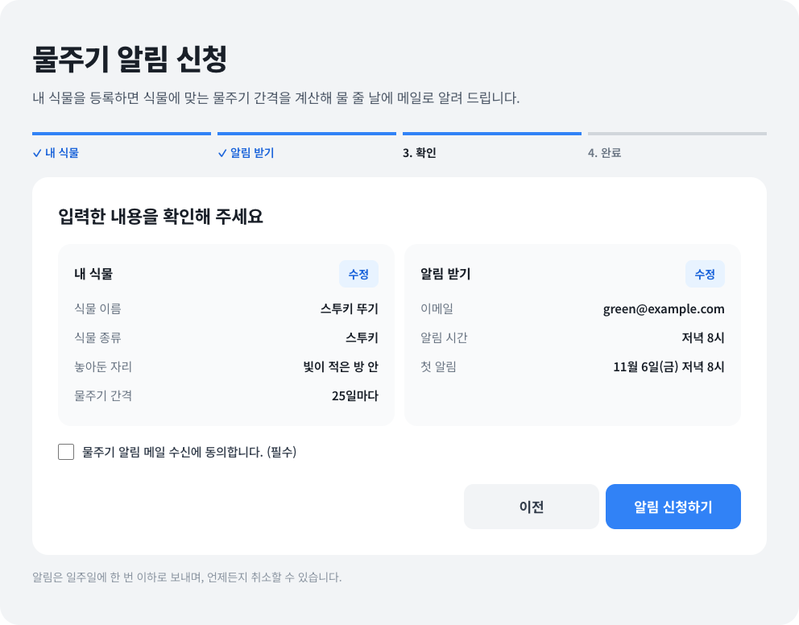 | 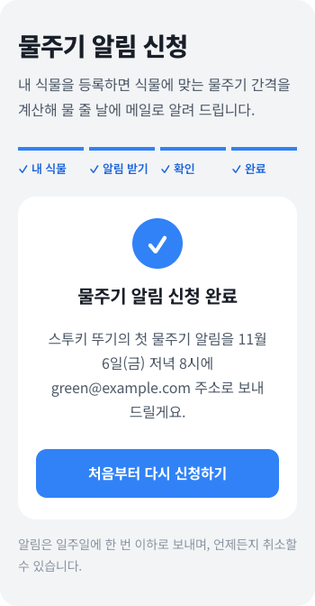 |

## 주요 기능 탭

`주요 기능` 섹션에서는 탭 3개를 눌러 기능을 바꿔 가며 직접 써 볼 수 있습니다. 선택한 탭은 흰 배경과 파란 굵은 글씨로 표시되고, 그 탭의 내용만 보입니다.

| 탭 | 사용자 행동 (이벤트) | 화면 반응 |
| --- | --- | --- |
| 물주기 알림 | 식물 종류·놓아둔 자리 선택 (`change`) → `오늘 물 줬어요` (`click`) | 물주기 간격 안내, 버튼 활성 → 다음 물주기 날짜를 파란 안내로 표시, 버튼은 `물주기 완료`로 바뀌고 비활성 |
| 사진 진단 | 잎 상태 선택 (`change`) | 증상별 해야 할 일 안내, 상태에 따라 파랑(건강)·주황(건조·빛 부족)·빨강(과습·해충) |
| 성장 일지 | 메모 입력 (`input`) → `일지에 기록하기` (`click`) | 글자 수 실시간 표시, 60자를 넘으면 빨간 안내와 버튼 비활성 → 오늘 날짜와 함께 일지 맨 위에 추가 |

| 물주기 알림 (1100px) | 사진 진단 (768px) | 성장 일지 60자 초과 (390px) |
| --- | --- | --- |
| 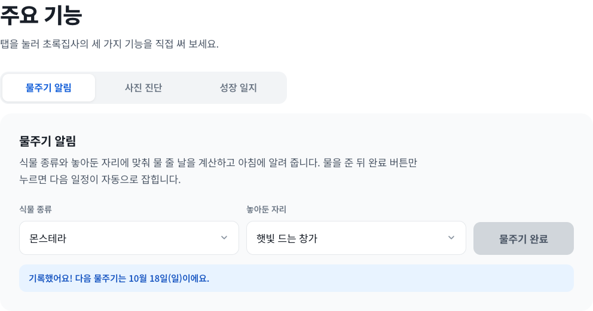 | 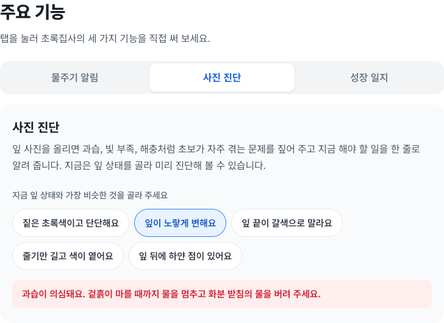 | 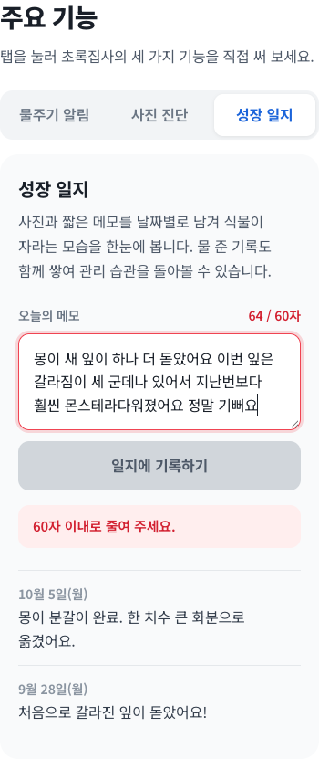 |

## 테스트 결과: 신청 흐름과 기존 기능

Chrome에서 화면 너비 1100px · 768px · 390px · 320px로 페이지를 열고, 위 시나리오를 실제로 클릭·입력·선택하며 확인했습니다. 중간고사 기능을 추가한 뒤에도 다시 실행해 모두 통과했습니다. 9주차 폼 개선 뒤에는 위 9주차 테스트와 함께, 탭 3개·생김새로 찾기·이전 시 값 유지·Enter 제출 오류·수정 반영·진행 표시·다시 시작을 다시 확인해 모두 통과했습니다. 390px과 320px은 모바일 화면(터치)으로 테스트했습니다. 단계마다 가로 스크롤이 생기거나 화면 밖으로 잘리는 요소가 있는지도 검사했습니다.

| 확인 항목 | 1100px | 768px | 390px | 320px |
| --- | :---: | :---: | :---: | :---: |
| 시작 화면만 보이고, `등록 시작하기`로 2단계 이동 | 통과 | 통과 | 통과 | 통과 |
| 빈 칸으로 `다음` → 다음 단계로 안 넘어가고 항목별 고치는 방법 안내 | 통과 | 통과 | 통과 | 통과 |
| 항목을 입력·선택하면 그 항목의 오류만 지워짐 | 통과 | 통과 | 통과 | 통과 |
| 이메일 형식 오류·시간 미선택 (Enter 키로 제출) | 통과 | 통과 | 통과 | 통과 |
| `이전`으로 돌아가도 입력·선택 값 유지 | 통과 | 통과 | 통과 | 통과 |
| 확인 화면에 입력값·물주기 간격·첫 알림 날짜 표시 | 통과 | 통과 | 통과 | 통과 |
| 확인 화면 `수정` → 값을 바꾸면 확인 화면에 반영 | 통과 | 통과 | 통과 | 통과 |
| 수신 동의 없이 신청 → 확인 단계 유지와 안내 | 통과 | 통과 | 통과 | 통과 |
| 완료 화면과 진행 표시 모두 ✓ | 통과 | 통과 | 통과 | 통과 |
| `처음부터 다시 신청하기` → 입력·선택·오류·진행 상태 초기화 | 통과 | 통과 | 통과 | 통과 |
| 기존 탭 기능 (탭 전환, 물주기 계산, 성장 일지 기록) | 통과 | 통과 | 통과 | 통과 |
| 가로 스크롤 · 잘린 요소 없음 (모든 단계) | 통과 | 통과 | 통과 | 통과 |
| 콘솔 JavaScript 오류 | 없음 | 없음 | 없음 | 없음 |

- 1100px: 식물 이름과 종류 입력칸이 두 칸으로 나란히 놓이고, 확인 화면의 `내 식물`·`알림 받기` 묶음도 나란히 보입니다.
- 768px 이하: 입력칸과 확인 묶음이 한 줄씩 쌓이고, 버튼은 전체 너비로 늘어나며 `다음`이 `이전` 위에 놓입니다.
- 390px·320px: 진행 표시 네 칸과 자리·시간 선택 버튼이 화면 안에 들어가고, 긴 문장과 이메일은 줄바꿈됩니다.

## 주차별 작업

| 주차 | 한 일 |
| --- | --- |
| 1~3주차 | HTML로 페이지 뼈대(소개·기능·이용 방법·신청 폼)를 만들고, CSS로 글꼴·카드·폼 스타일 적용 (수업 예제인 발표 훈련 서비스로 실습) |
| 4주차 | 예제를 내 서비스 `초록집사`로 바꾸고, 768px 이하 화면에 맞는 반응형 레이아웃 적용 |
| 5주차 | 알림 신청 폼에 JavaScript 입력 확인과 결과 안내, 버튼 상태 변경 추가 |
| 6주차 | 주요 기능을 탭 3개로 바꾸고, 물주기 계산·잎 상태 진단·성장 일지 체험 기능 추가 |
| 7주차 | 알림 신청 폼을 시작 → 내 식물 → 알림 받기 → 확인 → 완료의 5단계 흐름으로 확장 |
| 중간고사 | 신청 흐름 2단계에 종류를 모를 때 생김새로 식물을 찾아 고르는 경로 추가, 식물 종류 3개(고무나무 · 스파티필름 · 선인장) 추가 |
| 9주차 | 신청 폼에 도움말, 문자 알림·직접 정하기 조건부 입력, 입력 중 글자 수·형식 표시, 실시간 오류 해제, 제출 중 상태와 성공·실패 처리(localStorage) 추가 |
| 10주차 | 상단 메뉴를 nav·ul·li로 바꾸고 현재 위치 표시(aria-current)와 모바일 메뉴 열기·닫기 추가, 내 식물 목록과 물 줄 때 필터(aria-pressed)·결과 안내 추가 |
| 11주차 | 웹 접근성 개선: 색 대비(axe 위반 58곳 → 0), 색 외 기호·문구로 상태 구분, 진한 초점 표시, 본문 바로가기, 탭 방향키 조작, 초점 이동, 버튼 이름 명확화, 동작 줄이기 대응 |
| 12주차 | 재사용 UI 컴포넌트: 모달(물주기 간격 계산 기준, 삭제 확인)과 아코디언(자주 묻는 질문) 추가, 탭을 공통 함수로 정리, 공통 CSS 클래스·이벤트 위임으로 구성 |
| 13주차 | 과업 기반 QA로 새로고침 시 작성 내용이 사라지는 문제 확인, 신청 흐름의 입력값·선택값·진행 단계 임시 보관(sessionStorage)과 복구 안내 추가, 다시 작성·저장 성공 시 임시값 삭제, 사용자 테스트 1차 관찰에 따라 지운 뒤 안내·확인 창 문구·복구 안내 버튼을 수정하고 같은 과업으로 2차 재검증 |

## 파일 구성

```
index.html          페이지 구조와 내용
style.css           디자인과 반응형 레이아웃
script.js           탭, 체험 기능, 신청 흐름(검사·조건부 입력·제출), 식물 찾기, 메뉴 현재 위치·모바일 메뉴, 내 식물 목록·필터, 모달·아코디언 동작, 작성 중인 신청 임시 보관·복구
assets/images/      서비스 소개 이미지
assets/readme/      README 화면 캡처
docs/               13주차 사용자 테스트 기록
```
