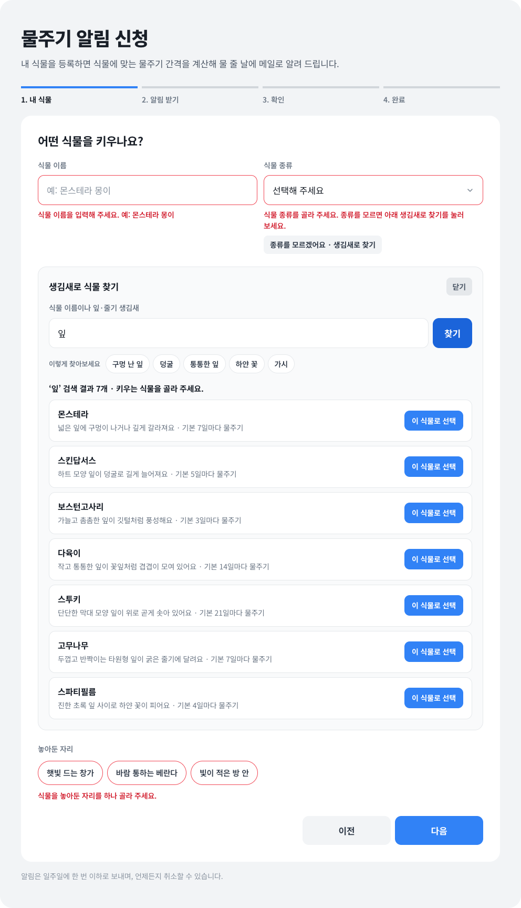
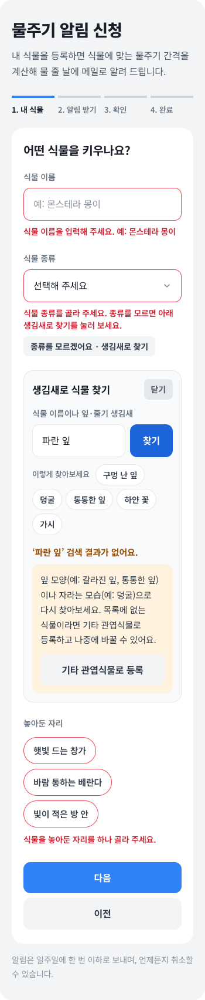
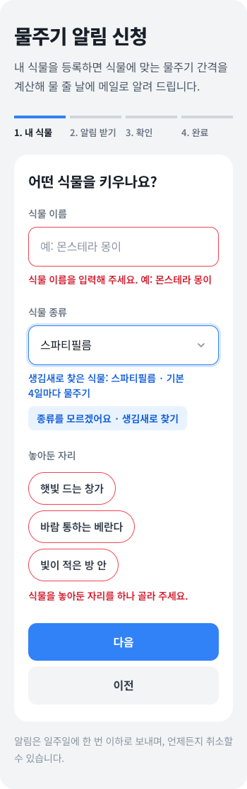
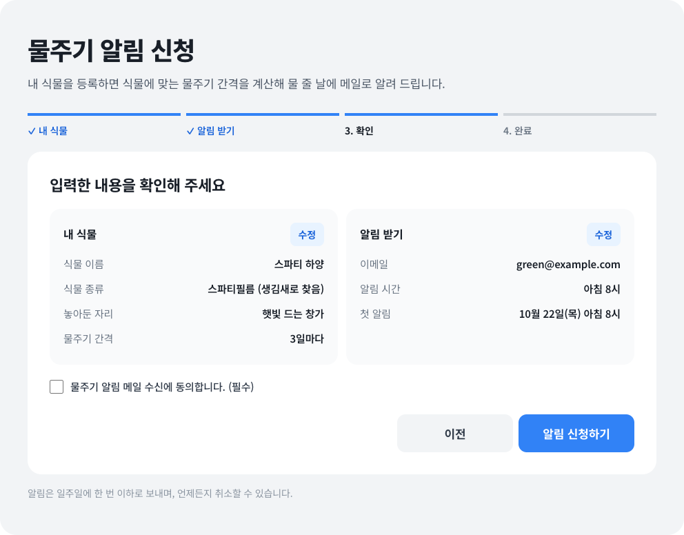
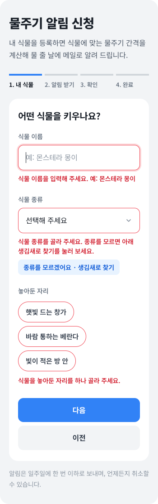
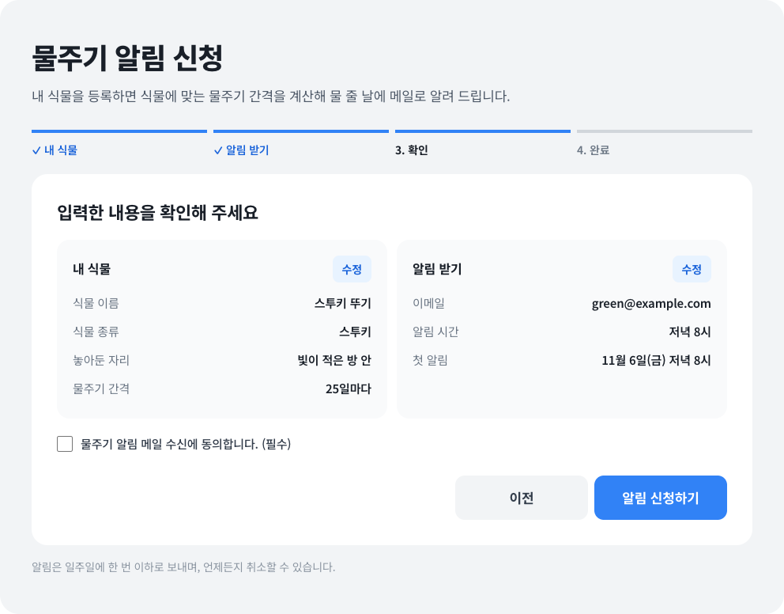
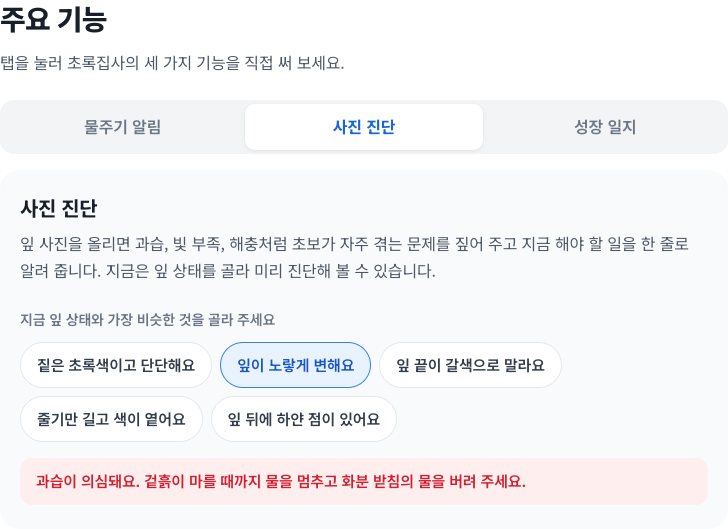

# 초록집사

식물을 처음 키우는 사람을 위한 반려식물 돌봄 서비스 소개 페이지입니다. uiuxprogramming 과제로 만들었습니다.

- 배포 페이지: https://jjiiiinn.github.io/uiuxprogramming/
- 저장소: https://github.com/JJIIIINN/uiuxprogramming

## 서비스 개요

| 항목 | 내용 |
| --- | --- |
| 주요 사용자 | 식물을 처음 키우는 자취생·직장인, 물 주는 시기를 자주 놓치는 사람 |
| 서비스 목적 | 식물마다 알맞은 물주기 일정을 알려 줘서 반려식물을 시들지 않게 키우도록 돕기 |
| 사용자 목표 | 내 식물에 맞는 날짜에 물주기 알림 받기 |
| 핵심 행동 | 내 식물을 등록하고 물주기 알림 신청하기 |
| 완료 조건 | 식물 이름·종류·놓아둔 자리와 이메일·알림 시간을 모두 입력하고, 확인 화면에서 수신 동의에 체크한 뒤 `알림 신청하기`를 누르면 완료 화면에 첫 알림 날짜가 표시됨 |

페이지 구성: 상단 바 → 첫 화면 → 서비스 소개 → 주요 기능(탭 3개) → 이용 방법 → 물주기 알림 신청 → 푸터

## 중간고사 추가 기능: 생김새로 식물 찾기

7주차 신청 흐름의 2단계(내 식물)에 **식물 종류를 모를 때 잎·줄기 생김새로 찾아 바로 고르는 경로**를 추가했습니다. "구멍 난 잎", "덩굴"처럼 생김새나 식물 이름을 입력하면 맞는 식물 목록이 나오고, 고른 식물이 신청 흐름의 식물 종류와 확인 화면에 반영됩니다.

- **사용자·목표와의 연결**: 주요 사용자인 식물 초보는 선물 받거나 사 온 식물의 종류 이름을 모르는 경우가 많습니다. 7주차 흐름에서는 종류를 모르면 2단계에서 막혀 목표(물주기 알림 받기)를 끝낼 수 없었습니다. 물주기 간격도 종류에 따라 달라지므로, 종류를 제대로 고르게 돕는 것이 알림의 정확도와도 이어집니다.
- **흐름과 연결한 지점**: 흐름의 중간인 2단계(내 식물)입니다. `식물 종류` 선택창 아래 `종류를 모르겠어요 · 생김새로 찾기` 버튼에서 시작합니다. 종류를 고르지 않고 `다음`을 누르면 나오는 오류 안내("종류를 모르면 아래 생김새로 찾기를 눌러 보세요.")도 이 기능으로 안내합니다.
- **입력과 버튼**: `식물 이름이나 잎·줄기 생김새` 검색창, 예시 검색어 버튼 5개(구멍 난 잎 · 덩굴 · 통통한 잎 · 하얀 꽃 · 가시), `찾기`, `이 식물로 선택`, `기타 관엽식물로 등록`(결과 없음일 때), `닫기`
- **찾는 방법**: 띄어쓰기를 무시하고 식물 8종의 이름 · 생김새 설명 · 검색어 목록과 비교합니다. 검색창에서 누른 Enter는 신청 흐름의 다음 단계로 넘어가지 않고 검색만 합니다. 한글을 조합하는 중에 누른 Enter는 무시해서 검색이 두 번 실행되지 않게 했습니다.

### 사용자 행동과 반응

| 사용자 행동 | 이벤트 | 확인할 조건 | 화면 반응 | 다음 행동 |
| --- | --- | --- | --- | --- |
| `종류를 모르겠어요 · 생김새로 찾기` 누름 | `click` | 찾기 영역이 닫혀 있음 | 찾기 영역을 펼치고 검색창에 커서, 버튼은 회색(펼침 상태)으로 바뀜 | 생김새 입력 또는 예시 검색어 누르기 |
| 검색어 입력 후 `찾기` 누름 또는 Enter | `click` / `keydown` | **성공**: 검색어가 있고 맞는 식물이 있음 | "‘구멍 난 잎’ 검색 결과 1개 · 키우는 식물을 골라 주세요."와 결과 카드(이름 · 생김새 · 기본 물주기 간격) 표시 | `이 식물로 선택` |
| 〃 | 〃 | **오류**: 검색어가 비어 있음 | 검색창 빨간 테두리와 "찾을 식물의 이름이나 생김새를 입력해 주세요. 예: 구멍 난 잎", 검색창에 커서 | 생김새 입력 (입력하면 오류 표시가 지워짐) |
| 〃 | 〃 | **결과 없음**: 맞는 식물이 없음 | 주황 글씨 "‘파란 잎’ 검색 결과가 없어요."와 다시 찾는 방법 안내 | 다른 생김새로 다시 찾기 또는 `기타 관엽식물로 등록` |
| 예시 검색어 버튼 누름 | `click` | - | 검색창에 검색어를 넣고 바로 검색 | `이 식물로 선택` |
| `이 식물로 선택` 누름 | `click` | - | 식물 종류 선택창에 반영, 종류 오류 지움, 찾기 영역 닫힘, 파란 글씨 "생김새로 찾은 식물: 스파티필름 · 기본 4일마다 물주기" | 자리를 고르고 `다음` → 확인 화면에 "스파티필름 (생김새로 찾음)"과 계산된 간격 표시 |
| `기타 관엽식물로 등록` 누름 | `click` | 결과 없음 상태 | 종류를 기타 관엽식물로 정하고 "목록에 없는 식물이라 기타 관엽식물(기본 7일마다)로 등록했어요." 안내 | `다음` |
| `닫기` 누름 (또는 찾기 버튼을 한 번 더 누름) | `click` | **취소**: 찾기 영역이 열려 있음 | 찾기 영역 닫힘, 식물 종류는 그대로, "식물 찾기를 닫았어요. 식물 종류는 그대로예요. 목록에서 고르거나 다시 찾아보세요." | 목록에서 직접 고르기 또는 다시 찾기 |
| 찾은 뒤 목록에서 종류를 직접 바꿈 | `change` | - | 찾기 안내를 지우고, 확인 화면의 "(생김새로 찾음)" 표시도 빠짐 | `다음` |
| 찾기를 다시 열거나 `이전`으로 갔다가 돌아옴 | `click` | - | 마지막 검색어와 결과를 그대로 유지 | 이어서 고르기 |
| `처음부터 다시 신청하기` 누름 | `click` | - | 검색어, 결과, 결과 없음 안내, 오류, 찾기 안내를 모두 지우고 찾기 영역을 닫음 | 새로 신청 |

**파일별 역할**
- HTML: 찾기 버튼, 검색창, 예시 검색어, 결과 목록, 결과 없음 안내의 구조를 담당합니다. `hidden`, `aria-expanded`, `aria-live`를 사용합니다.
- CSS: 펼침 상태의 버튼 색, 오류 테두리, 결과 없음의 주황 안내, 결과 카드를 표현하고, 모바일에서는 `이 식물로 선택` 버튼을 전체 너비로 배치합니다.
- JavaScript: 이벤트(`click` · `keydown` · `input` · `change`)를 연결하고, 검색 조건을 판단해 결과 목록을 만들고, 신청 흐름의 식물 종류와 확인 화면에 반영하고, 초기화합니다.

### 중간고사 기능 테스트 결과

Chrome 브라우저를 스크립트(Puppeteer)로 조작해 화면 너비 1100px · 768px · 390px · 320px에서 실제 클릭 · 터치 · 키 입력을 실행하고, 화면에 나타난 문구와 상태를 확인했습니다. 390px과 320px은 모바일 터치로 조작했습니다.

| 경로 | 시험한 내용 | 1100px | 768px | 390px | 320px |
| --- | --- | :---: | :---: | :---: | :---: |
| 정상 | "구멍 난 잎" 입력 후 Enter → 몬스테라 1개, 신청 흐름은 2단계 그대로 | 통과 | 통과 | 통과 | 통과 |
| 정상 | 예시 "하얀 꽃" → 스파티필름 → `이 식물로 선택` → 선택창 반영, 안내 표시, 찾기 닫힘 | 통과 | 통과 | 통과 | 통과 |
| 정상 | 이어서 신청 → 확인 화면에 "스파티필름 (생김새로 찾음)", 창가 기준 3일마다 | 통과 | 통과 | 통과 | 통과 |
| 정상 | 넓은 검색어 "잎" → 결과 7개 목록 | 통과 | 통과 | 통과 | 통과 |
| 오류 | 빈 검색창으로 `찾기` → 안내, 빨간 테두리, 검색창에 커서 / 입력하면 오류 지움 | 통과 | 통과 | 통과 | 통과 |
| 오류 연결 | 종류 없이 `다음` → 종류 오류 안내에서 생김새로 찾기 안내 | 통과 | 통과 | 통과 | 통과 |
| 결과 없음 | "파란 잎" → 결과 없음 안내 → `기타 관엽식물로 등록` → 종류 반영, 종류 오류 지움 | 통과 | 통과 | 통과 | 통과 |
| 취소 | `닫기` → 찾기 닫힘, 종류 그대로, 다음 행동 안내, 찾기 버튼에 커서 | 통과 | 통과 | 통과 | 통과 |
| 수정 | 찾은 뒤 목록에서 직접 변경 → 안내 지움 / 확인 화면 `수정`으로 돌아와 선인장으로 변경 → 확인 화면에 "선인장", 17일마다 | 통과 | 통과 | 통과 | 통과 |
| 값 유지 | 찾기를 다시 열거나 `이전`으로 갔다가 돌아와도 검색어와 결과 유지 | 통과 | 통과 | 통과 | 통과 |
| 초기화 | 신청 완료 후 `처음부터 다시 신청하기` → 찾기 관련 상태 모두 초기화 | 통과 | 통과 | 통과 | 통과 |
| 화면 | 모든 상태에서 가로 넘침 · 잘림 · 버튼과 입력창 겹침 없음 | 통과 | 통과 | 통과 | 통과 |
| 기존 기능 | 7주차 신청 흐름과 주요 기능 탭 다시 확인 (아래 테스트 결과) | 통과 | 통과 | 통과 | 통과 |
| 콘솔 JavaScript 오류 | - | 없음 | 없음 | 없음 | 없음 |

| 검색 결과 (1100px) | 결과 없음 (390px) |
| --- | --- |
|  |  |

| 선택 후 안내 (390px) | 확인 화면 반영 (1100px) |
| --- | --- |
|  |  |

## 사용자 흐름: 물주기 알림 신청

페이지 맨 아래 `물주기 알림 신청`에서 시작부터 완료까지 다섯 단계로 진행합니다. 상단 메뉴의 `알림 신청`이나 첫 화면의 `물주기 알림 받기` 버튼으로도 바로 이동할 수 있습니다.

| 단계 | 화면 제목 | 사용자가 하는 일 | 다음 단계로 가는 조건 |
| --- | --- | --- | --- |
| 1. 시작 | 내 식물 등록하고 물주기 알림 받기 | 필요한 정보를 확인하고 `등록 시작하기` | 없음 |
| 2. 내 식물 (입력·선택) | 어떤 식물을 키우나요? | 식물 이름 입력, 식물 종류 선택(모르면 생김새로 찾기), 놓아둔 자리 선택 | 세 항목 모두 입력·선택 |
| 3. 알림 받기 (입력·선택) | 알림을 어디로 보내 드릴까요? | 이메일 입력, 알림 받을 시간 선택 | 이메일 형식이 맞고 시간을 고름 |
| 4. 확인 | 입력한 내용을 확인해 주세요 | 입력 내용과 계산된 물주기 간격·첫 알림 날짜 확인, 필요하면 `수정`, 수신 동의 체크 | 수신 동의 체크 |
| 5. 완료 | 물주기 알림 신청 완료 | 결과 확인, 필요하면 `처음부터 다시 신청하기` | - |

- 진행 표시(`1. 내 식물 · 2. 알림 받기 · 3. 확인 · 4. 완료`)는 시작 다음 단계부터 현재 단계를 파란 막대와 굵은 글씨로, 지난 단계를 ✓로 표시합니다. 완료하면 네 칸이 모두 ✓로 바뀝니다.
- 물주기 간격은 `식물별 기본 간격 × 자리별 비율`로 계산합니다. 예를 들어 몬스테라(7일)를 햇빛 드는 창가(0.8)에 두면 6일마다입니다. 주요 기능의 `물주기 알림` 탭과 같은 계산 함수를 사용합니다.

## 인터랙션 시나리오

| 사용자 행동 | 이벤트 | 조건 | 화면 반응 | 다음 상태 |
| --- | --- | --- | --- | --- |
| `등록 시작하기` 누름 | `click` | - | 시작 화면을 숨기고 2단계 표시, 진행 표시 1칸 강조 | 2. 내 식물 |
| 2단계에서 `다음` 누름 또는 Enter | `submit` | 이름·종류·자리가 모두 있음 | 3단계 표시, 진행 표시 1칸 ✓ | 3. 알림 받기 |
| 〃 | `submit` | 하나라도 비어 있음 | 빠진 항목마다 빨간 테두리와 고치는 방법 안내(예: "식물 이름을 입력해 주세요. 예: 몬스테라 몽이"), 첫 번째 빠진 항목으로 커서 이동 | 2단계 유지 |
| 오류가 난 항목을 입력·선택 | `input` / `change` | 그 항목에 오류 표시 중 | 그 항목의 빨간 테두리와 안내 문구 지움 | 현재 단계 유지 |
| 3단계에서 `다음` 누름 또는 Enter | `submit` | 이메일 형식이 맞고 시간을 고름 | 입력값으로 확인 화면을 채워 표시 | 4. 확인 |
| 〃 | `submit` | 이메일이 비었거나 형식이 틀림, 또는 시간 미선택 | "이메일 주소 형식을 확인해 주세요. 예: green@example.com", "알림 받을 시간을 하나 골라 주세요." 안내 | 3단계 유지 |
| `이전` 누름 | `click` | - | 바로 앞 단계 표시, 입력·선택한 값은 그대로 | 앞 단계 |
| 확인 화면에서 `수정` 누름 | `click` | - | 해당 단계(내 식물 또는 알림 받기)로 이동, 값 유지 | 2단계 또는 3단계 → 다시 `다음`을 누르면 수정한 값이 확인 화면에 반영 |
| `알림 신청하기` 누름 | `submit` | 수신 동의 체크함 | 완료 화면에 "○○의 첫 물주기 알림을 11월 6일(금) 저녁 8시에 … 주소로 보내 드릴게요." 표시, 진행 표시 모두 ✓ | 5. 완료 |
| 〃 | `submit` | 수신 동의 안 함 | 체크박스 빨간 테두리와 "알림 메일을 받으려면 수신 동의에 체크해 주세요." 안내 | 4단계 유지 |
| `처음부터 다시 신청하기` 누름 | `click` | - | 모든 입력·선택·동의, 오류 표시, 확인 내용, 진행 표시를 초기화하고 시작 화면 표시 | 1. 시작 |

| 2단계 누락 안내 (390px) | 확인 화면 (1100px) | 완료 화면 (390px) |
| --- | --- | --- |
|  |  |  |

## 주요 기능 탭

`주요 기능` 섹션에서는 탭 3개를 눌러 기능을 바꿔 가며 직접 써 볼 수 있습니다. 선택한 탭은 흰 배경과 파란 굵은 글씨로 표시되고, 그 탭의 내용만 보입니다.

| 탭 | 사용자 행동 (이벤트) | 화면 반응 |
| --- | --- | --- |
| 물주기 알림 | 식물 종류·놓아둔 자리 선택 (`change`) → `오늘 물 줬어요` (`click`) | 물주기 간격 안내, 버튼 활성 → 다음 물주기 날짜를 파란 안내로 표시, 버튼은 `물주기 완료`로 바뀌고 비활성 |
| 사진 진단 | 잎 상태 선택 (`change`) | 증상별 해야 할 일 안내, 상태에 따라 파랑(건강)·주황(건조·빛 부족)·빨강(과습·해충) |
| 성장 일지 | 메모 입력 (`input`) → `일지에 기록하기` (`click`) | 글자 수 실시간 표시, 60자를 넘으면 빨간 안내와 버튼 비활성 → 오늘 날짜와 함께 일지 맨 위에 추가 |

| 물주기 알림 (1100px) | 사진 진단 (768px) | 성장 일지 60자 초과 (390px) |
| --- | --- | --- |
|  |  |  |

## 테스트 결과: 신청 흐름과 기존 기능

Chrome에서 화면 너비 1100px · 768px · 390px · 320px로 페이지를 열고, 위 시나리오를 실제로 클릭·입력·선택하며 확인했습니다. 중간고사 기능을 추가한 뒤에도 다시 실행해 모두 통과했습니다. 390px과 320px은 모바일 화면(터치)으로 테스트했습니다. 단계마다 가로 스크롤이 생기거나 화면 밖으로 잘리는 요소가 있는지도 검사했습니다.

| 확인 항목 | 1100px | 768px | 390px | 320px |
| --- | :---: | :---: | :---: | :---: |
| 시작 화면만 보이고, `등록 시작하기`로 2단계 이동 | 통과 | 통과 | 통과 | 통과 |
| 빈 칸으로 `다음` → 다음 단계로 안 넘어가고 항목별 고치는 방법 안내 | 통과 | 통과 | 통과 | 통과 |
| 항목을 입력·선택하면 그 항목의 오류만 지워짐 | 통과 | 통과 | 통과 | 통과 |
| 이메일 형식 오류·시간 미선택 (Enter 키로 제출) | 통과 | 통과 | 통과 | 통과 |
| `이전`으로 돌아가도 입력·선택 값 유지 | 통과 | 통과 | 통과 | 통과 |
| 확인 화면에 입력값·물주기 간격·첫 알림 날짜 표시 | 통과 | 통과 | 통과 | 통과 |
| 확인 화면 `수정` → 값을 바꾸면 확인 화면에 반영 | 통과 | 통과 | 통과 | 통과 |
| 수신 동의 없이 신청 → 확인 단계 유지와 안내 | 통과 | 통과 | 통과 | 통과 |
| 완료 화면과 진행 표시 모두 ✓ | 통과 | 통과 | 통과 | 통과 |
| `처음부터 다시 신청하기` → 입력·선택·오류·진행 상태 초기화 | 통과 | 통과 | 통과 | 통과 |
| 기존 탭 기능 (탭 전환, 물주기 계산, 성장 일지 기록) | 통과 | 통과 | 통과 | 통과 |
| 가로 스크롤 · 잘린 요소 없음 (모든 단계) | 통과 | 통과 | 통과 | 통과 |
| 콘솔 JavaScript 오류 | 없음 | 없음 | 없음 | 없음 |

- 1100px: 식물 이름과 종류 입력칸이 두 칸으로 나란히 놓이고, 확인 화면의 `내 식물`·`알림 받기` 묶음도 나란히 보입니다.
- 768px 이하: 입력칸과 확인 묶음이 한 줄씩 쌓이고, 버튼은 전체 너비로 늘어나며 `다음`이 `이전` 위에 놓입니다.
- 390px·320px: 진행 표시 네 칸과 자리·시간 선택 버튼이 화면 안에 들어가고, 긴 문장과 이메일은 줄바꿈됩니다.

## 주차별 작업

| 주차 | 한 일 |
| --- | --- |
| 1~3주차 | HTML로 페이지 뼈대(소개·기능·이용 방법·신청 폼)를 만들고, CSS로 글꼴·카드·폼 스타일 적용 (수업 예제인 발표 훈련 서비스로 실습) |
| 4주차 | 예제를 내 서비스 `초록집사`로 바꾸고, 768px 이하 화면에 맞는 반응형 레이아웃 적용 |
| 5주차 | 알림 신청 폼에 JavaScript 입력 확인과 결과 안내, 버튼 상태 변경 추가 |
| 6주차 | 주요 기능을 탭 3개로 바꾸고, 물주기 계산·잎 상태 진단·성장 일지 체험 기능 추가 |
| 7주차 | 알림 신청 폼을 시작 → 내 식물 → 알림 받기 → 확인 → 완료의 5단계 흐름으로 확장 |
| 중간고사 | 신청 흐름 2단계에 종류를 모를 때 생김새로 식물을 찾아 고르는 경로 추가, 식물 종류 3개(고무나무 · 스파티필름 · 선인장) 추가 |

## 파일 구성

```
index.html          페이지 구조와 내용
style.css           디자인과 반응형 레이아웃
script.js           탭, 체험 기능, 신청 흐름, 식물 찾기 동작
assets/images/      서비스 소개 이미지
assets/readme/      README 화면 캡처
```
